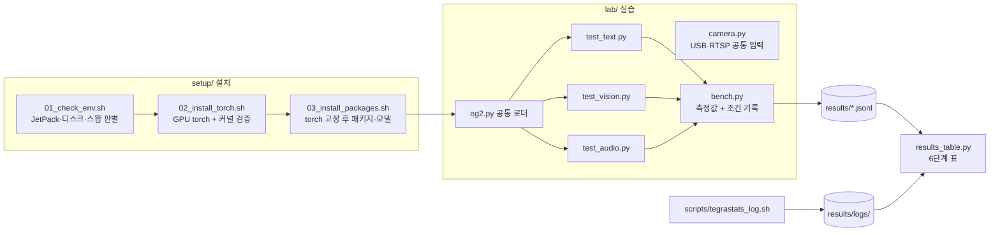

# Jetson Orin LLM 에이전트 실습: EmbeddingGemma 2 멀티모달 임베딩

Jetson Orin Nano Super 8GB 에서 EmbeddingGemma 2 로 텍스트·이미지·동영상·음성을 하나의 벡터 공간에서 검색하고, IP 카메라 응용으로 넓히는 실습 저장소입니다.

- **해결하는 문제**: 강의자료는 JetPack 6·USB 웹캠 기준이라 우리 장비(JetPack 7, IP 카메라)에서 그대로 돌지 않습니다. 이 저장소는 장비 차이를 자동으로 판별해 설치하고, 모든 측정값을 측정 조건과 함께 파일로 남깁니다.
- **핵심 결과 숫자** (2호기, MAXN_SUPER, bfloat16): 텍스트 검색 6/6 정답, 질의 2개 151 ms·초당 13.3 질의, 모델 메모리 +579 MB, 보드 전력 약 8.5 W. 음성 검색 2/3 정답. [6단계 성능 표](#6단계-성능-측정)
- **시연 링크**: 준비 중
- 강의자료 정리와 장비별 주의점: [docs/00-lecture-summary.md](docs/00-lecture-summary.md)

## 구성



| 경로 | 역할 |
| --- | --- |
| `setup/01_check_env.sh` | JetPack 6/7, NVMe 부팅 여부, 스왑, 전력 모드를 읽기만 해서 자료의 어느 명령을 건너뛸지 알려 줌 |
| `setup/02_install_torch.sh` | `~/eg2` venv, JetPack 에 맞는 torch 설치, 실제 GPU 행렬곱으로 검증, 버전 고정 파일 생성 |
| `setup/03_install_packages.sh` | torch 고정 상태로 sentence-transformers 6.1+ 설치, 모델 미리 받기, `lab/check.py` 실행 |
| `lab/eg2.py` | 필요한 인코더만 골라 올리는 로더 (bfloat16) |
| `lab/test_text.py` `test_vision.py` `test_audio.py` | 3·4·5단계. 데우기 후 두 번째 실행 지연을 재고 정답 여부를 기록 |
| `lab/bench.py` | 지연, 로드 전후 RAM, torch 할당량, 측정 조건(전력 모드·L4T·버전·커밋)을 `results/<단계>.jsonl` 에 추가 |
| `lab/results_table.py` | `results/` 와 tegrastats 로그로 6단계 표를 Markdown 으로 출력 |
| `lab/camera.py` | USB 번호와 RTSP 주소를 같은 방식으로 열고, 최신 프레임만 유지해 RTSP 지연 누적을 막음 |
| `scripts/record_clip.sh` | IP 카메라에서 10초 녹화 + 2초마다 프레임 추출 (4단계 자료) |
| `scripts/make_audio_samples.sh` | 합성 음성·경보음·잡음을 16 kHz 모노로 생성 (5단계 자료) |
| `scripts/tegrastats_log.sh` | 측정 중 tegrastats 를 시각과 함께 `results/logs/` 에 저장 |

## 실행 방법

아래 명령은 모두 **Jetson 에 ssh 접속한 창**에서 실행합니다. 처음 한 번만 저장소를 받습니다.

```bash
git clone https://github.com/AIP-1-3/jetson_orin_LLM_agent_AIGJ_01_002.git ~/eg2-lab
```

```bash
cd ~/eg2-lab
```

### 1~2단계 설치

```bash
./setup/01_check_env.sh
```

출력에서 "NVMe 로 부팅 중"이면 자료의 SSD 포맷 명령을, "스왑 이미 있음"이면 스왑 추가를 건너뜁니다.

```bash
./setup/02_install_torch.sh
```

마지막에 `capability (8, 7)`, `bf16 True`, 숫자 하나가 나오면 성공입니다. `no kernel image` 가 나오면 휠이 장비와 맞지 않는 것입니다.

```bash
./setup/03_install_packages.sh
```

`torch ... cuda True` 와 sentence-transformers 6.1 이상이 출력되면 성공입니다.

### 3~5단계 테스트

측정할 때는 tmux 창을 둘로 나눠 한쪽에서 tegrastats 를 기록합니다.

```bash
./scripts/tegrastats_log.sh 03_text
```

다른 창에서:

```bash
source ~/eg2/bin/activate
```

```bash
cd ~/eg2-lab/lab && python test_text.py
```

```bash
python test_text.py --no-prompt
```

GPU 사용률과 처리량을 보려면 tegrastats 를 짧은 간격으로 켜고 연속 추론합니다.

```bash
TS_MS=200 ./scripts/tegrastats_log.sh 03_text
```

```bash
python test_text.py --sustain 10
```

4단계는 IP 카메라 주소를 `.env` 에 넣은 뒤 자료를 만듭니다.

```bash
cd ~/eg2-lab && cp .env.example .env && nano .env
```

```bash
./scripts/record_clip.sh
```

```bash
cd lab && python test_vision.py --judge Y Y Y
```

`--judge` 는 질의별 1위 이미지를 눈으로 보고 맞으면 Y, 틀리면 N 으로 적습니다.

```bash
cd ~/eg2-lab && ./scripts/make_audio_samples.sh
```

```bash
cd lab && python test_audio.py
```

### 6단계 성능 측정

```bash
python results_table.py
```

출력된 표를 아래에 붙여 넣습니다. 숫자는 `results/` 파일에서만 가져옵니다.

2호기 실측 (2026-10-23, 근거: [`results/03_text.jsonl`](results/03_text.jsonl), [`results/05_audio.jsonl`](results/05_audio.jsonl), [`results/logs/`](results/logs/) tegrastats 0.5초 간격)

| 구성 | 입력 | 실행 전 RAM (MB) | 로드 후 RAM (MB) | 모델 증가분 (MB) | 최대 RAM (MB) | 지연 (ms) | GPU 사용률 평균/최대 (%) | 전력 평균/최대 (mW) | 정답 | 커밋 |
| --- | --- | --- | --- | --- | --- | --- | --- | --- | --- | --- |
| 텍스트 전용 (270M) | 질의 2개 dim=768 | 4751 | 5330 | 579 | 5622 | 151.5 | 4/31 | 8023/8698 | 6/6 | ee8051b |
| 텍스트 전용 (270M) | 질의 2개 dim=256 | 4751 | 5330 | 579 | 5622 | 151.9 | 4/31 | 8023/8698 | 6/6 | ee8051b |
| 텍스트 전용 (270M) | 질의 2개 dim=128 | 4751 | 5330 | 579 | 5622 | 150.6 | 4/31 | 8023/8698 | 6/6 | ee8051b |
| 텍스트 전용 (270M) | 반복 10초 dim=768 | 4751 | 5330 | 579 | 5622 | 처리량 13.3 질의/초 (10초) | 4/31 | 8023/8698 | 6/6 | ee8051b |
| +오디오 (570M) | WAV 3개 | 4763 | 5711 | 948 | 6412 | 427.9 | 2/76 | 7964/10884 | 2/3 | ee8051b |

측정 조건: NVIDIA Jetson Orin Nano Engineering Reference Developer Kit Super, NV Power Mode: MAXN_SUPER, # R39 (release), REVISION: 2.1, GCID: 46758480, BOARD: generic, EABI: aarch64, DATE: Fri Aug  7 05:54:22 AM UTC 2026, torch 2.14.1+cu132, sentence-transformers 6.2.0, bfloat16
RAM 은 시스템 전체 사용량(MemTotal - MemAvailable). 다른 프로세스가 쓰는 양이 섞이므로 모델 몫은 '모델 증가분'(로드 후 - 실행 전)으로 본다. tegrastats 로그가 있으면 최대 RAM·GPU·전력은 로그 전체 구간(모델 로드 포함) 값.

읽는 법과 해석:

- **모델 메모리**: 텍스트 전용은 로드 후 579 MB, 오디오 인코더를 더하면 948 MB 늘었습니다. 측정 전에도 데스크톱 세션(Firefox, gnome-shell, Xorg)과 다른 프로그램이 약 4.7 GB 를 쓰고 있었고, 오디오 단계 최대 6412 MB 로 전체 7485 MB 의 86% 까지 올라갔습니다. 8~10단계에서 YOLO 를 함께 올리려면 데스크톱 브라우저를 닫거나 헤드리스로 돌려야 합니다.
- **텍스트 지연과 처리량**: 질의 2개 한 번에 약 151 ms, 10초 연속으로는 초당 13.3 질의입니다. 차원(768/256/128)을 줄여도 지연이 같은 이유는 모델 계산은 같고 결과 벡터만 자르기 때문입니다.
- **GPU 가 덜 쓰임**: 10초 연속 추론 구간의 GPU 사용률은 10~13%, 전력은 약 8.5 W 였습니다. 질의 2개짜리 작은 묶음이라 GPU 보다 토큰화·파이썬 쪽 처리가 시간을 더 쓰는 것으로 추정합니다. 묶음 크기를 키워 처리량이 오르는지 확인하는 것이 다음 실험입니다.
- **차원별 점수**: 정답 문서 점수는 768 → 128 로 갈수록 0.717 → 0.785 로 올랐지만, 짧은 벡터는 서로 비슷해지는 경향이 있어 점수 자체보다 1위가 바뀌는지(6/6 유지)를 기준으로 봅니다.
- **음성**: 경보음·잡음은 맞게 찾았고, 합성 음성은 잡음으로 잘못 찾았습니다 (아래 문제 해결 기록 4).

## 기술적 판단

| 무엇 | 왜 (대안과 버린 이유) | 어떻게 |
| --- | --- | --- |
| JetPack 버전 자동 판별 | 자료의 jp6/cu126 인덱스는 Python 3.10 전용이라 JetPack 7(Python 3.12)에서 `from versions: none` 으로 실패 (자료 Q1). 수동 선택은 실수 여지가 있음 | `/etc/nv_tegra_release` 의 R 번호로 분기 (R36 → 6, R38·R39 → 7) |
| torchaudio 제외 | cu132 인덱스에 torchaudio 가 없어 PyPI cu130 판이 섞이면 transformers import 가 깨짐 (자료 Q7). 세 패키지를 모두 cu130 으로 맞추는 대안은 커널 재검증 부담이 큼 | 오디오는 soundfile·librosa 로 읽음 |
| 지연은 두 번째 실행 값 | 첫 실행은 CUDA 초기화가 섞여 비교가 불공정 | 데우기 1회 후 `torch.cuda.synchronize()` 로 감싸 측정 |
| RAM 은 시스템 전체 사용량 | Jetson 은 CPU·GPU 가 메모리를 공유해 프로세스 RSS 에 GPU 사용량이 안 보임 | `/proc/meminfo` 의 MemTotal - MemAvailable + torch 할당량 + tegrastats 로그 |
| RTSP 최신 프레임만 유지 | OpenCV 버퍼에 프레임이 쌓이면 처리 지연이 수 초로 늘어남 | 읽기 전용 스레드 + 끊기면 재연결 (`lab/camera.py`) |
| 카메라 계정은 `.env` | 코드·git·로그에 계정이 남으면 유출 | `.env` 는 git 제외, 로그에는 `rtsp://***@` 로 가림 |

## 문제 해결 기록

### 1. 원격 실행에서 sudo 비밀번호 때문에 torch 설치가 멈춤 (2026-10-23, 2호기)

- **증상**: `./setup/02_install_torch.sh` 가 venv 를 만들기 전에 종료 (exit 1)
  ```
  설치 필요: ffmpeg
  libopenblas-dev (관리자 계정이 아니면 관리자에게 요청)
  sudo: a terminal is required to read the password; either use the -S option to read from standard input or configure an askpass helper
  sudo: a password is required
  ```
- **원인**: 2호기에 `ffmpeg`, `libopenblas-dev` 가 없었고, 스크립트가 원격(비대화식) 세션에서 `sudo apt install` 을 불러 비밀번호를 받을 수 없었습니다. 이어서 `01_check_env.sh` 로 2호기에는 CUDA 툴킷(`/usr/local/cuda`), cuDNN, TensorRT 가 설치돼 있지 않다는 것도 확인했습니다 (1호기는 설치돼 있음).
- **해결**: 관리자 계정 터미널에서 빠진 패키지를 설치합니다. 스크립트는 비대화식이고 `sudo -n` 이 안 되면 설치 명령을 안내하고 끝나도록 바꿨습니다.
- **재발 방지**: `01_check_env.sh` 가 빠진 apt 패키지와 CUDA 툴킷 유무를 sudo 없이 먼저 알려 줍니다. 02 를 돌리기 전에 알 수 있습니다.

### 2. 경보음·잡음 샘플을 만들 수 없음: NVIDIA 판 ffmpeg 에 lavfi 없음 (2026-10-23, 2호기)

- **증상**: `./scripts/make_audio_samples.sh` 가 경보음 단계에서 종료되어 `test_audio.py` 가 "wav 가 없습니다"로 끝남
  ```
  [in#0 @ 0xaaaae5cbefc0] Unknown input format: 'lavfi'
  Error opening input file sine=frequency=1000:duration=3.
  Error opening input files: Invalid argument
  ```
- **원인**: `nvidia-jetpack` 설치 때 함께 들어온 NVIDIA 판 ffmpeg(7:8.0.1-nvidia1)는 꼭 필요한 기능만 넣어 빌드돼서 lavfi 입력과 sine·anoisesrc 필터가 없습니다. 강의자료의 명령은 Ubuntu 판 ffmpeg 를 가정합니다.
- **해결**: 경보음(1 kHz 3초)과 핑크 잡음(5초)을 numpy 로 만들고, 16 kHz 모노 변환도 librosa 로 합니다 (`lab/make_audio_samples.py`). 시스템 ffmpeg 를 Ubuntu 판으로 되돌리는 대안은 Jetson 영상 가속 패키지와 얽혀 있어 버렸습니다.
- **재발 방지**: 테스트 자료 생성은 시스템 도구 대신 venv 안의 파이썬 패키지로 해서 장비마다 ffmpeg 빌드가 달라도 같은 파일이 나옵니다 (잡음은 시드 0 고정).

### 3. 1초 간격 tegrastats 에 GPU 사용률이 0% 로 찍힘 (2026-10-23, 2호기)

- **증상**: 텍스트 테스트 중 tegrastats 24줄 가운데 23줄이 `GR3D_FREQ 0%`, 1줄만 12%
- **원인**: 질의 2개 추론이 약 150 ms 라서 1초마다 한 번 찍는 샘플에 거의 걸리지 않습니다. GPU 를 안 쓴 것이 아니라 측정 방법의 한계입니다.
- **해결**: `test_text.py --sustain 10` 으로 10초 동안 연속 추론하며 처리량(질의/초)을 재고, `TS_MS=200` 으로 tegrastats 간격을 줄입니다.

### 4. 합성 음성을 "냉방 요청 목소리"로 찾지 못함 (2026-10-23, 2호기, 미해결)

- **증상**: `test_audio.py` 에서 3개 중 1개 틀림
  ```
  [NG] '덥다고 냉방을 요청하는 목소리' -> noise.wav (0.651)
  [OK] '날카로운 경보음' -> beep.wav (0.702)
  [OK] '웅웅거리는 배경 소음' -> noise.wav (0.682)
  ```
- **원인 (추정)**: espeak-ng 합성음은 사람 목소리보다 기계음에 가까워서 "목소리" 질의와 덜 닮았을 수 있습니다. 강의자료도 합성음은 점수가 낮게 나올 수 있다고 적고 있습니다. 아직 확인하지 않았습니다.
- **확인 계획**: 사람 목소리를 녹음해 같은 질의로 비교하고, 질의 문구("사람이 말하는 소리")를 바꿔 결과가 바뀌는지 봅니다.

## 진행 기록

| 날짜 | 한 일 | 근거 |
| --- | --- | --- |
| 2026-10-23 | 강의자료 정리, 장비 차이 분석 | [PR #1](https://github.com/AIP-1-3/jetson_orin_LLM_agent_AIGJ_01_002/pull/1) |
| 2026-10-23 | 1~6단계 설치·테스트·측정 코드 (장비 실행 전) | [PR #2](https://github.com/AIP-1-3/jetson_orin_LLM_agent_AIGJ_01_002/pull/2) |
| 2026-10-23 | 2호기 첫 실행: 환경 점검 통과, torch 설치에서 sudo 로 멈춤 → 스크립트 보강 | [PR #4](https://github.com/AIP-1-3/jetson_orin_LLM_agent_AIGJ_01_002/pull/4), 문제 해결 기록 1 |
| 2026-10-23 | 2호기 1~3단계 완료 (torch 2.14.1+cu132, 텍스트 검색 6/6 정답). 다른 프로세스 RAM 이 섞여 모델 증가분 열 추가, tegrastats 를 sudo 없이도 기록 | [PR #5](https://github.com/AIP-1-3/jetson_orin_LLM_agent_AIGJ_01_002/pull/5) |
| 2026-10-23 | 음성 샘플 생성을 파이썬으로 교체, 연속 추론 처리량 측정 추가 | [PR #6](https://github.com/AIP-1-3/jetson_orin_LLM_agent_AIGJ_01_002/pull/6), 문제 해결 기록 2·3 |
| 2026-10-23 | 2호기 3·5단계 측정 결과와 tegrastats 로그 커밋, 표에 전력·처리량 추가 | 이 PR, 6단계 표, 문제 해결 기록 4 |

## AI 활용과 검증

- 단계: 강의자료 요약, 장비 차이 분석, 설치 스크립트와 측정 코드 작성에 Claude Code 를 썼습니다.
- 검증: 클라우드 환경에서 Python 문법 검사, 셸 문법 검사, 가짜 측정 파일로 `results_table.py` 출력 확인까지 했습니다. 2호기 실기 실행은 원격으로 진행했고, 측정값은 장비가 남긴 `results/*.jsonl` 과 tegrastats 로그를 그대로 옮겨 커밋했습니다 (로그는 필요한 항목만 뽑은 축약본).
- AI 가 놓친 점: 처음 만든 `.gitignore` 의 `.env.*` 규칙이 `.env.example` 까지 막는 것을 리뷰 중에 발견해 예외 규칙을 넣었습니다. 처음 스크립트는 sudo 비밀번호가 필요한 상황, NVIDIA 판 ffmpeg, 1초 간격 샘플의 한계를 예상하지 못했고, 모두 실기 실행에서 드러나 고쳤습니다 (문제 해결 기록 1~3). 원격 연결 상태를 잘못 읽어 "재부팅으로 끊겼다"고 잘못 안내한 일도 있었는데, `uptime -s` 와 `last -x reboot` 로 재부팅이 없었음을 확인해 바로잡았습니다.

## 개인정보와 안전

- 카메라 녹화·이미지(`media/`)는 사람이 찍힐 수 있어 git 에 올리지 않습니다.
- 공용 장비 규칙(재부팅, `nvpmodel`/`jetson_clocks` 변경, `apt upgrade` 금지)은 팀 저장소 `jetson_orin` 의 CLAUDE.md 를 따릅니다. 2호기는 단독 사용 장비입니다.
