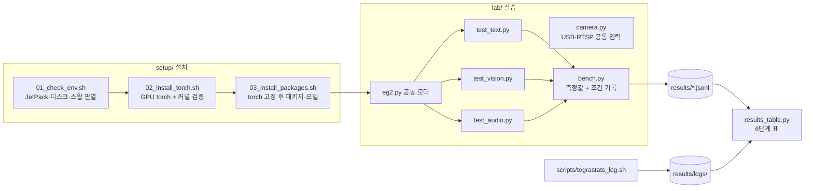

# Jetson Orin LLM 에이전트 실습: EmbeddingGemma 2 멀티모달 임베딩

Jetson Orin Nano Super 8GB 에서 EmbeddingGemma 2 로 텍스트·이미지·동영상·음성을 하나의 벡터 공간에서 검색하고, IP 카메라 응용으로 넓히는 실습 저장소입니다.

- **해결하는 문제**: 강의자료는 JetPack 6·USB 웹캠 기준이라 우리 장비(JetPack 7, IP 카메라)에서 그대로 돌지 않습니다. 이 저장소는 장비 차이를 자동으로 판별해 설치하고, 모든 측정값을 측정 조건과 함께 파일로 남깁니다.
- **핵심 결과 숫자** (2호기, MAXN_SUPER, bfloat16): 텍스트 검색 6/6 정답, 질의 2개 151 ms·초당 13.3 질의(묶음 32 로 넣으면 초당 145.9 질의, 22배), 모델 메모리 +579 MB, 보드 전력 약 8.5 W. IP 카메라 848×480 약 28 fps 수신, 이미지 5장 임베딩 2.5~2.9 초, 10장 5.9 초(순간 GPU 99%·최대 20.2 W, 10장 한 묶음은 RAM 97% → 4장씩 나눠 넣도록 수정). 장면별 사진 검색 1/3 정답(원인 분석 포함). 음성 검색 2/3 정답. 도메인 미세 조정 accuracy@1 0.833 → 0.850(1 epoch 74.8 초, 일반 질의 24/24 → 21/24 트레이드오프). 물체 검출 11.8~13.3 fps, 임베딩으로 라벨 교정(tv → monitor). 자세 인식 13.6~13.8 fps, 손 흔들기 시간 패턴 판정 동작. [6단계 성능 표](#6단계-성능-측정)
- **시연 링크**: 준비 중
- 강의자료 정리와 장비별 주의점: [docs/00-lecture-summary.md](docs/00-lecture-summary.md)

## 구성



| 경로 | 역할 |
| --- | --- |
| `setup/01_check_env.sh` | JetPack 6/7, NVMe 부팅 여부, 스왑, 전력 모드를 읽기만 해서 자료의 어느 명령을 건너뛸지 알려 줌 |
| `setup/02_install_torch.sh` | `~/eg2` venv, JetPack 에 맞는 torch 설치, 실제 GPU 행렬곱으로 검증, 버전 고정 파일 생성 |
| `setup/03_install_packages.sh` | torch 고정 상태로 sentence-transformers 6.1+·opencv-python-headless 설치, 모델 미리 받기, `lab/check.py` 실행 |
| `lab/eg2.py` | 필요한 인코더만 골라 올리는 로더 (bfloat16) |
| `lab/test_text.py` `test_vision.py` `test_audio.py` | 3·4·5단계. 데우기 후 두 번째 실행 지연을 재고 정답 여부를 기록 |
| `lab/bench.py` | 지연, 로드 전후 RAM, torch 할당량, 측정 조건(전력 모드·L4T·버전·커밋)을 `results/<단계>.jsonl` 에 추가 |
| `lab/results_table.py` | `results/` 와 tegrastats 로그로 6단계 표를 Markdown 으로 출력 |
| `lab/camera.py` | USB 번호와 RTSP 주소를 같은 방식으로 열고, 최신 프레임만 유지해 RTSP 지연 누적을 막음 |
| `scripts/record_clip.sh` | IP 카메라에서 10초 녹화 + 2초마다 프레임 저장 (4단계 자료, `lab/record_clip.py` 호출) |
| `lab/record_clip.py` | OpenCV 로 RTSP 를 받아 `clip.mp4`(mp4v)와 `frame_NN.jpg` 저장, 받은 fps 출력 |
| `scripts/make_audio_samples.sh` | 합성 음성·경보음·잡음을 16 kHz 모노로 생성 (5단계 자료) |
| `scripts/tegrastats_log.sh` | 측정 중 tegrastats 를 시각과 함께 `results/logs/` 에 저장 |

## 실행 방법

아래 명령은 모두 **Jetson 에 ssh 접속한 창**에서 실행합니다. 처음 한 번만 저장소를 받습니다.

```bash
git clone https://github.com/AIP-1-3/jetson_orin_LLM_agent_AIGJ_01_002.git ~/eg2-lab
```

```bash
cd ~/eg2-lab
```

### 1~2단계 설치

```bash
./setup/01_check_env.sh
```

출력에서 "NVMe 로 부팅 중"이면 자료의 SSD 포맷 명령을, "스왑 이미 있음"이면 스왑 추가를 건너뜁니다.

```bash
./setup/02_install_torch.sh
```

마지막에 `capability (8, 7)`, `bf16 True`, 숫자 하나가 나오면 성공입니다. `no kernel image` 가 나오면 휠이 장비와 맞지 않는 것입니다.

```bash
./setup/03_install_packages.sh
```

`torch ... cuda True` 와 sentence-transformers 6.1 이상이 출력되면 성공입니다.

### 3~5단계 테스트

측정할 때는 tmux 창을 둘로 나눠 한쪽에서 tegrastats 를 기록합니다.

```bash
./scripts/tegrastats_log.sh 03_text
```

다른 창에서:

```bash
source ~/eg2/bin/activate
```

```bash
cd ~/eg2-lab/lab && python test_text.py
```

```bash
python test_text.py --no-prompt
```

GPU 사용률과 처리량을 보려면 tegrastats 를 짧은 간격으로 켜고 연속 추론합니다.

```bash
TS_MS=200 ./scripts/tegrastats_log.sh 03_text
```

```bash
python test_text.py --sustain 10
```

4단계는 IP 카메라 주소를 `.env` 에 넣은 뒤 자료를 만듭니다.

```bash
cd ~/eg2-lab && cp .env.example .env && nano .env
```

```bash
./scripts/record_clip.sh
```

```bash
cd lab && python test_vision.py --judge Y Y Y
```

`--judge` 는 질의별 1위 이미지를 눈으로 보고 맞으면 Y, 틀리면 N 으로 적습니다.

```bash
cd ~/eg2-lab && ./scripts/make_audio_samples.sh
```

```bash
cd lab && python test_audio.py
```

### 6단계 성능 측정

```bash
python results_table.py
```

출력된 표를 아래에 붙여 넣습니다. 숫자는 `results/` 파일에서만 가져옵니다.

2호기 실측 (2026-10-23, 근거: [`results/03_text.jsonl`](results/03_text.jsonl), [`results/04_vision.jsonl`](results/04_vision.jsonl), [`results/05_audio.jsonl`](results/05_audio.jsonl), [`results/logs/`](results/logs/) tegrastats 0.5초 간격, 4단계는 0.2초 간격)

| 구성 | 입력 | 실행 전 RAM (MB) | 로드 후 RAM (MB) | 모델 증가분 (MB) | 최대 RAM (MB) | 지연 (ms) | GPU 사용률 평균/최대 (%) | 전력 평균/최대 (mW) | 정답 | 커밋 |
| --- | --- | --- | --- | --- | --- | --- | --- | --- | --- | --- |
| 텍스트 전용 (270M) | 질의 2개 dim=768 | 4751 | 5330 | 579 | 5622 | 151.5 | 4/31 | 8023/8698 | 6/6 | ee8051b |
| 텍스트 전용 (270M) | 질의 2개 dim=256 | 4751 | 5330 | 579 | 5622 | 151.9 | 4/31 | 8023/8698 | 6/6 | ee8051b |
| 텍스트 전용 (270M) | 질의 2개 dim=128 | 4751 | 5330 | 579 | 5622 | 150.6 | 4/31 | 8023/8698 | 6/6 | ee8051b |
| 텍스트 전용 (270M) | 반복 10초 dim=768 | 4751 | 5330 | 579 | 5622 | 처리량 13.3 질의/초 (10초) | 4/31 | 8023/8698 | 6/6 | ee8051b |
| +비전 (440M) | 이미지 6장 | 4981 | 5384 | 403 | 6390 | 2879.4 | 17/99 | 9984/20167 | 1/3 | 1e1eabf |
| +오디오 (570M) | WAV 3개 | 4763 | 5711 | 948 | 6412 | 427.9 | 2/76 | 7964/10884 | 2/3 | ee8051b |

측정 조건: NVIDIA Jetson Orin Nano Engineering Reference Developer Kit Super, NV Power Mode: MAXN_SUPER, # R39 (release), REVISION: 2.1, GCID: 46758480, BOARD: generic, EABI: aarch64, DATE: Fri Aug  7 05:54:22 AM UTC 2026, torch 2.14.1+cu132, sentence-transformers 6.2.0, bfloat16
RAM 은 시스템 전체 사용량(MemTotal - MemAvailable). 다른 프로세스가 쓰는 양이 섞이므로 모델 몫은 '모델 증가분'(로드 후 - 실행 전)으로 본다. tegrastats 로그가 있으면 최대 RAM·GPU·전력은 로그 전체 구간(모델 로드 포함) 값.

읽는 법과 해석:

- **모델 메모리**: 텍스트 전용은 로드 후 579 MB, 오디오 인코더를 더하면 948 MB 늘었습니다. 측정 전에도 데스크톱 세션(Firefox, gnome-shell, Xorg)과 다른 프로그램이 약 4.7 GB 를 쓰고 있었고, 오디오 단계 최대 6412 MB 로 전체 7485 MB 의 86% 까지 올라갔습니다. 8~10단계에서 YOLO 를 함께 올리려면 데스크톱 브라우저를 닫거나 헤드리스로 돌려야 합니다. 10단계(카메라 2대)는 2호기 IP 카메라와 1호기 USB 카메라를 함께 씁니다.
- **텍스트 지연과 처리량**: 질의 2개 한 번에 약 151 ms, 10초 연속으로는 초당 13.3 질의입니다. 차원(768/256/128)을 줄여도 지연이 같은 이유는 모델 계산은 같고 결과 벡터만 자르기 때문입니다.
- **GPU 가 덜 쓰임**: 10초 연속 추론 구간의 GPU 사용률은 10~13%, 전력은 약 8.5 W 였습니다. 질의 2개짜리 작은 묶음이라 GPU 보다 토큰화·파이썬 쪽 처리가 시간을 더 쓰는 것으로 추정합니다. 아래 묶음 크기 실험에서 묶음을 32로 키우자 GPU 가 85~99% 로 차고 처리량이 22배 올라, 이 추정이 맞았습니다.
- **차원별 점수**: 정답 문서 점수는 768 → 128 로 갈수록 0.717 → 0.785 로 올랐지만, 짧은 벡터는 서로 비슷해지는 경향이 있어 점수 자체보다 1위가 바뀌는지(6/6 유지)를 기준으로 봅니다.
- **이미지 (4단계)**: IP 카메라(VIGI C540-W, 보조 스트림)에서 848×480 영상을 5초에 142프레임(28.4 fps) 받았고, 10초 녹화에서 2초마다 프레임 5장을 저장했습니다. 5장 임베딩에 1차 2921 ms, 2차 2518 ms, 20초 녹화로 10장을 넣은 3차(표의 값)는 5938 ms 로 장당 약 0.5~0.6 초가 꾸준히 걸렸고, 이 구간에서 GPU 98~99%, 보드 전력이 최대 19.5~20.2 W 까지 올라 지금까지 단계 중 가장 무겁습니다. 텍스트·음성과 달리 이미지 인코더는 GPU 를 꽉 채웁니다.
- **이미지 메모리 주의**: 비전의 "실행 전 RAM 5235 MB" 는 파이썬이 라이브러리를 일부 올린 뒤의 값이고, 같은 로그의 시작값은 4695 MB 입니다. 그래서 모델 증가분 290~334 MB 는 실제보다 작게 잡혔을 수 있고, torch 가 잡은 GPU 메모리(로드 후 849 MB, 최대 1225 MB)를 함께 봐야 합니다. 최대 RAM 약 6.8 GB 로 전체의 90~91% 입니다. 10장을 한 번에 넣은 3차는 torch 최대 1593 MB, 시스템 RAM 최대 7262~7280 MB(전체의 97%)까지 올라 스왑 직전이었습니다(문제 해결 기록 10). 그래서 `test_vision.py` 를 4장씩 나눠 넣도록 바꿨습니다.
- **장면별 사진 검색 1/3 정답**: 카메라를 빈 자리·칠판·사람 쪽으로 차례로 돌려 4초씩 찍은 6장(빈 자리 3, 칠판 1, 사람 2)으로 다시 쟀습니다(표의 값, 2회 실행 점수 동일). 장면 이름을 파일 이름에 넣어 정답을 자동 판정합니다([PR #13](https://github.com/AIP-1-3/jetson_orin_LLM_agent_AIGJ_01_002/pull/13)).

  | 질의 | 기대 장면 | 1위 (점수) | 기대 장면 최고 (점수) | 차이 | 판정 |
  | --- | --- | --- | --- | --- | --- |
  | 사람이 없는 빈 강의실 | empty | board_01 (0.625) | empty_02 (0.596) | -0.029 | NG |
  | 학생들이 앉아 수업을 듣는 모습 | people | board_01 (0.608) | people_02 (0.565) | -0.043 | NG |
  | 화이트보드에 쓴 글씨 | board | board_01 (0.621) | board_01 (0.621) | +0.021 | OK |

  세 질의 모두 board_01 이 1위였습니다. 6장 중 강의실 전체가 넓게 보이는 사진이 board_01 하나뿐이라, "강의실"·"수업" 이 들어간 질의를 모두 끌어간 것으로 봅니다. 빈 자리 사진은 책상을 가까이 낮게, 사람 사진은 한 사람을 가까이 찍어 질의의 "강의실 장면" 과 구도가 달랐습니다. 그래도 기대 장면이 2위에 와서(빈 강의실 → empty_02, 사람 → people_02) 의미 구분 자체는 되고 있습니다. 공정하게 비교하려면 같은 구도에서 장면만 바꿔 찍어야 하고, 이것이 다음 개선점입니다. 사람 사진에는 얼굴이 나와 저장소에 올리지 않았습니다.
- **이전 촬영 (판정 없음)**: 1차 촬영은 카메라가 회색 천에 가깝게 놓여 5장이 거의 같은 화면이었습니다. 카메라를 실습실 책상 쪽으로 돌린 2차 촬영(표의 값)에서는 질의별 1위 점수가 "학생들이 앉아 수업을 듣는 모습" 0.622, "사람이 없는 빈 강의실" 0.596, "화이트보드에 쓴 글씨" 0.596 으로, 장면과 맞는 질의가 약 0.026 높았습니다. 다만 고정 카메라로 2초 간격으로 찍어 5장이 같은 장면이라 프레임끼리 점수 차는 0.002~0.004 이고, 빈 강의실·화이트보드 장면은 아예 없었습니다. 3차 10장에서는 사람 두 명이 찍힌 프레임이 "학생들이 앉아 수업을 듣는 모습" 1위였지만 2위 프레임과 차이가 0.006 뿐이었습니다. 녹화 중 앱으로 카메라를 돌리려 했으나 화면이 움직이지 않아, 장면(빈 자리·사람·칠판)마다 카메라를 먼저 돌려 놓고 4초씩 따로 찍는 방식(`record_clip.sh 4 <장면이름>`)으로 바꿔 다시 잽니다. 프레임에 사람이 찍혀 있어 이미지 파일은 저장소에 올리지 않았습니다. 동영상 검색은 문제 해결 기록 9 때문에 이번에는 빠졌습니다(`--no-video`).
- **음성**: 경보음·잡음은 맞게 찾았고, 합성 음성은 잡음으로 잘못 찾았습니다 (아래 문제 해결 기록 4).

### 묶음 크기 실험 (최적화 전/후)

- **무엇**: 텍스트 질의를 한 번에 몇 개씩 넣느냐(묶음 크기)에 따라 처리량·전력·메모리가 어떻게 바뀌는지 쟀습니다.
- **왜**: 3단계 연속 추론에서 GPU 가 10~13% 만 쓰였습니다. 묶음을 키우면 같은 GPU 로 더 많이 처리할 수 있는지 확인하려는 것입니다. 대안인 TensorRT 변환은 sentence-transformers 다중 입력 모델에서 손이 많이 들어, 코드 한 줄로 되는 묶음 크기부터 봤습니다.
- **어떻게**: `lab/bench_batch.py --sizes 1 8 32 --seconds 10`. 크기마다 10초 동안 쉬지 않고 인코딩하고, 크기 사이에 2초 쉽니다. tegrastats 는 0.2초 간격이고, 아래 GPU·전력·RAM 은 크기별 10초 구간만 잘라 계산했습니다. 조건은 2호기, MAXN_SUPER, bfloat16, 텍스트 전용 270M, 커밋 1e1eabf 입니다. 근거는 [`results/06_batch.jsonl`](results/06_batch.jsonl), [`results/logs/06_batch_20261023-160823.log`](results/logs/06_batch_20261023-160823.log) 입니다.

| 묶음 크기 | 처리량 (질의/초) | 묶음당 지연 (ms) | GPU 평균/최대 (%) | 전력 평균/최대 (W) | 질의당 에너지 (J) | 최대 RAM (MB) |
| --- | --- | --- | --- | --- | --- | --- |
| 1 (전) | 6.5 | 155 | 20/39 | 9.55/10.88 | 1.47 | 5459 |
| 8 | 47.2 | 170 | 35/53 | 11.44/12.46 | 0.24 | 5537 |
| 32 (후) | 145.9 | 219 | 85/99 | 17.35/19.12 | 0.12 | 5677 |

- **결과**:
  - 처리량이 6.5 → 145.9 질의/초로 22배 올랐습니다. 묶음당 지연은 155 → 219 ms 로 1.4배만 늘었습니다.
  - 전력은 1.8배 올랐지만 처리량이 더 크게 올라, 질의당 에너지가 약 12분의 1 이 됐습니다. 질의당 에너지는 평균 전력 ÷ 처리량으로 계산했습니다.
  - RAM 증가는 218 MB, torch 최대 할당은 651 MB 로 메모리 부담이 작았습니다.
- **해석과 한계**:
  - 묶음 1 에서는 GPU 가 거의 놀고 있었습니다. 시간이 토큰화·파이썬 호출 같은 고정 비용에 쓰였다는 뜻입니다.
  - 측정 전부터 다른 GPU 사용이 약 11% 있어, 묶음 1 의 GPU 20% 에는 이 기본값이 섞여 있습니다.
  - 실시간 한 건 응답(에이전트 질문 1개)은 묶음을 키울 수 없으므로 155 ms 가 그대로입니다. 묶음은 문서 색인처럼 한꺼번에 넣는 작업에 씁니다.

### 8~9단계 카메라 응용

자료는 USB 웹캠(`cv2.VideoCapture(0)`)을 가정하지만, 2호기는 IP 카메라라서 입력을 `lab/camera.py` 의 `LatestFrame` 으로 바꿨습니다. 같은 코드가 1호기 USB 카메라(`--source 0`)에서도 돕니다. 검출이 카메라보다 느려도 최신 프레임만 처리해 지연이 쌓이지 않고, 같은 프레임을 두 번 판정하지 않습니다. `--seconds N` 을 주면 N초 뒤 끝내면서 fps·라벨·동작 횟수를 `results/08_objects.jsonl`·`results/09_pose.jsonl` 에 남깁니다.

```bash
bash setup/04_install_detect.sh
```

```bash
cd lab && python app.py --mode yolo --seconds 120
```

```bash
cd lab && python pose_app.py --raw --seconds 120
```

브라우저에서 `http://<2호기 Tailscale 주소>:8000` 으로 실시간 영상과 검색 화면을 봅니다. 사람은 크롭·저장하지 않습니다(8단계 `SKIP_CLASSES`). 9단계는 관절 좌표만 다룹니다.

**8단계 실측** (2호기, MAXN_SUPER, bfloat16, VIGI RTSP 848×480, 각 60초, 커밋 93ea6d9). 근거는 [`results/08_objects.jsonl`](results/08_objects.jsonl), [`08_objects_20261023-163931.log`](results/logs/08_objects_20261023-163931.log)(5초마다 1줄로 줄임)입니다.

| 모드 | 검출 fps 평균/최소 | 크롭당 임베딩 | 검출 → 최종 라벨 | 최대 RAM | GPU 평균/최대 | 전력 평균/최대 |
| --- | --- | --- | --- | --- | --- | --- |
| yolo (conf 0.5) | 11.8 / 5.7 | 801.8 ms | tv 2, laptop 1 → 그대로 | 6352 MB (85%) | 16% / 99% | 9.5 W / 15.3 W |
| relabel (conf 0.35) | 13.3 / 6.6 | 792.6 ms | tv 2 → **monitor 2** | 6317 MB (84%) | 15% / 98% | 9.5 W / 16.0 W |
| yoloe (conf 0.25) | 12.7 / 6.8 | - (크롭 0) | 지정 물체 검출 없음 | 6261 MB (84%) | 26% / 68% | 10.6 W / 11.8 W |
| relabel 재측정 (물건 배치) | 11.9 / 4.7 | 686.4 ms | tv 5 → **monitor 5**, backpack 3, cup 2, teddy bear 1 → **mouse 1** | 6265 MB (84%) | 20% / 99% | 10.1 W / 16.1 W |

- relabel 모드가 COCO 의 "tv" 로 잡힌 모니터 2개를 비전 임베딩으로 "monitor" 로 바로잡았습니다. 자료가 보여 주려는 "검출기 라벨을 임베딩으로 고친다" 가 실제 교실 영상에서 동작한 사례입니다.
- 검출은 11.8~13.3 fps 로 카메라 수신(약 28 fps)보다 느립니다. 최신 프레임만 처리하는 구조라 지연이 쌓이지 않았습니다. GPU 평균이 낮은 것은 yolo11n 이 작아 프레임마다 잠깐만 쓰기 때문이고, 98~99% 피크는 크롭 임베딩(비전 440M) 때입니다(tegrastats 시각 기준 추정).
- yoloe 는 문장으로 지정한 물체 목록에서 conf 0.25 를 넘은 것이 없어 크롭이 0개였습니다. 측정 시각에 화면에는 주로 9단계를 준비하는 사람이 있었고, 사람은 저장하지 않습니다. 첫 실행에서 yoloe 가중치(27.8 MB)와 문장 인코더 `mobileclip_blt.ts`(600 MB)를 받느라 약 4분 40초가 걸렸습니다. 그래서 측정 구간은 다운로드 뒤 16:51:30~16:52:44 만 따로 계산했습니다([`08_objects_20261023-164645.log`](results/logs/08_objects_20261023-164645.log)).
- 책상에 컵·가방 등을 올려 둔 재측정(17:07, 커밋 05c80af)에서는 4종류 11개를 잘라 냈습니다. 검출기가 "teddy bear" 로 본 물체를 임베딩이 "mouse" 로 다시 붙였습니다. 다만 크롭 사진을 눈으로 확인하지는 않아 실제 마우스였는지는 확인 전입니다. 근거는 [`08_objects_20261023-170706.log`](results/logs/08_objects_20261023-170706.log) 입니다. 크롭 사진은 저장소에 올리지 않습니다.

**9단계 실측** (2호기, VIGI RTSP, yolo11n-pose float16, 각 120초, 커밋 6540d00). 민서가 카메라 앞에서 가만히 서기 → 한 팔 들기 → 손 흔들기 → 만세를 반복했습니다. 사람 이미지는 저장하지 않고 동작 판정만 [`results/09_pose.jsonl`](results/09_pose.jsonl) 에 남겼습니다. tegrastats 는 [`09_pose_20261023-165246.log`](results/logs/09_pose_20261023-165246.log) 입니다.

| 모드 | fps 평균/최소 | 판정 횟수 | 최대 RAM | GPU 평균/최대 | 전력 평균/최대 |
| --- | --- | --- | --- | --- | --- |
| raw (규칙만, 프레임마다) | 13.6 / 5.9 | 한팔들기 16 | 5364 MB | 19% / 54% | 9.7 W / 10.9 W |
| 기본 (0.6초 다수결 + 손 흔들기) | 13.8 / 4.6 | 한팔들기 18, 손흔들기 23 | 5179 MB | 19% / 50% | 9.7 W / 10.6 W |
| 기본 + 손 흔들기 1초 유지, 앉은 자세 (재측정) | 13.6 / 5.0 | **만세 5**, 한팔들기 16, 손흔들기 16 | 5222 MB | 17% / 69% | 9.4 W / 10.5 W |

- 시간 패턴 판정이 동작했습니다. raw 는 손 흔들기를 판정하지 않아 같은 동작이 모두 한팔들기로 나왔고, 기본 모드는 손흔들기 23번을 따로 잡았습니다.
- 처음 두 측정은 서서 했고 만세가 0번이었습니다. 두 손목이 모두 어깨 위로 충분히(어깨 너비의 0.3배 이상) 올라가야 하는데, 손이 화면 위로 잘렸다고 보고 앉은 자세로 다시 쟀더니 만세가 5번 잡혔습니다([`09_pose_20261023-170432.log`](results/logs/09_pose_20261023-170432.log)). 손목 좌표를 직접 재는 자리 확인은 임시 스크립트 오류로 실패해, 화면 여백 숫자는 남기지 못했습니다.
- 첫 기본 모드 측정은 횟수가 부풀려져 있습니다. 손 흔들기 도중 한팔들기와 손흔들기가 깜빡였기 때문이고, 1초 유지를 넣은 재측정에서 줄었습니다(문제 해결 기록 13).
- 자세 모델만 올라가 RAM 이 8단계보다 약 1 GB 가볍고 torch 최대 할당은 44 MB 입니다.

### 7단계 도메인 미세 조정

강의실 운영 질의-문서 쌍으로 텍스트 모델(270M)을 추가 학습하고, 학습 전후 검색 정확도를 비교합니다. 데이터는 [data/README.md](data/README.md) 에 있습니다. 학습 282쌍, 평가 60쌍이고 서로 겹치지 않습니다. 평가는 `lab/eval_ir.py` 로 했고, 근거는 [`results/07_finetune.jsonl`](results/07_finetune.jsonl) 입니다.

| 모델 | accuracy@1 | accuracy@3 | accuracy@5 | ndcg@10 | mrr@10 | 학습 시간 |
| --- | --- | --- | --- | --- | --- | --- |
| 기준 (google/embeddinggemma-2) | 0.833 | 0.967 | 0.983 | 0.923 | 0.898 | - |
| 미세 조정 (eg2-classroom, 3 epoch) | **0.850** | 0.983 | 0.983 | 0.937 | 0.916 | 216.6 초 |
| 미세 조정 (eg2-classroom-e1, 1 epoch) | **0.850** | 0.967 | 0.983 | 0.934 | 0.912 | 74.8 초 |

- **결과**: 도메인 평가 accuracy@1 이 0.833 → 0.850 으로 올랐습니다. 60개 중 1개를 더 맞힌 정도라 작은 개선입니다. 기준 모델이 이미 50개를 1위로 맞혀 남은 폭이 작았습니다.
- **학습 조건**: 2호기, MAXN_SUPER, bfloat16, 배치 8×누적 2, 3 epoch(54 step, 약 3.7 초/step), lr 2e-5, 토큰 임베딩 표 고정(학습 파라미터 271.0M 중 136.8M), 최대 128 토큰.
- **자원**: 학습 구간 tegrastats RAM 최대 7156/7485 MB(96%), 스왑 약 1.2 GB 사용, GPU 사용률 평균 29%·최대 61%, 전력 평균 약 11.0 W(5초 표본 50개)·최대 14.1 W(tegrastats 누적 최대값)([`07_finetune_20261023-161852.log`](results/logs/07_finetune_20261023-161852.log), 학습 구간은 5초마다 1줄로 줄임). GPU 가 자주 놀았던 것은 메모리가 빠듯해 스왑을 오가며 기다린 탓으로 봅니다(추정).
- **epoch 별 변화가 없음**: loss 는 2.36(step 10) → 0.57(step 50)로 계속 내려갔지만, 평가 지표는 epoch 1·2·3 이 모두 같았습니다(`log_history`). 평가 질의 60개의 1위 문서가 epoch 1 이후 바뀌지 않았다는 뜻입니다. 도메인 효과는 1 epoch 에서 거의 다 났습니다.
- **일반 질의 성능이 떨어짐 (트레이드오프)**: 3단계 질의 2개(× 768/256/128 차원)를 그대로 다시 돌렸더니 기준 6/6 → 미세 조정 3/6 이 됐습니다. 맞힌 질의도 점수가 0.10~0.16 낮아졌습니다(예: 냉방 질의 0.725 → 0.599). 원인과 범위는 아래 1 epoch 비교에서 더 쟀습니다.
- **1 epoch 비교 실험**: 1 epoch 만 학습해도 accuracy@1 은 0.850 으로 같았습니다. 학습 시간은 74.8 초로 3 epoch 의 약 1/3 입니다. 학습 구간 RAM 최대 7095 MB(95%), GPU 평균 28%·최대 76%, 전력 평균 10.8 W 였습니다(원본 284줄 기준, 저장소에는 학습 구간을 5초마다 1줄로 줄인 [`07_finetune_20261023-162923.log`](results/logs/07_finetune_20261023-162923.log)).

일반 성능은 `lab/check_general.py` 로 세 모델을 같은 조건에서 다시 쟀습니다([`results/07_general.jsonl`](results/07_general.jsonl)). 3단계 질의 2개와, 강의실과 무관한 생활·지식 질의 6개(찌개, 지하철, 광합성, 마라톤, 고양이, 파이썬)를 768/256/128 차원에서 각각 봅니다. "차이" 는 정답 문서 점수에서 정답이 아닌 문서 중 최고 점수를 뺀 값입니다(음수면 틀림).

| 모델 | 3단계 질의 (6) | 일반 질의 (18) | 합계 | "졸리고 머리가 맑지 않아요" 차이 (768/256/128) | 냉방 질의 1위 점수 (dim 768) |
| --- | --- | --- | --- | --- | --- |
| 기준 | 6/6 | 18/18 | **24/24** | +0.006 / +0.007 / +0.003 | 0.725 |
| 3 epoch | 3/6 | 18/18 | 21/24 | -0.010 / -0.013 / -0.028 | 0.599 |
| 1 epoch | 3/6 | 18/18 | 21/24 | -0.003 / -0.003 / -0.004 | 0.677 |

- 세 모델이 다르게 답한 것은 "졸리고 머리가 맑지 않아요" 한 질의뿐입니다. 기준 모델도 차이가 +0.003~+0.007 로 아슬아슬하게 맞혔던 질의라, 학습 데이터의 조도·환기 문서 쪽으로 공간이 조금만 움직여도 뒤집혔습니다.
- 강의실과 동떨어진 일반 질의는 학습 뒤에도 모두 맞혔습니다. 1위 점수는 내려갔지만 2위와의 차이는 오히려 커졌습니다(예: 파이썬 질의 dim 768 차이 기준 +0.252, 1 epoch +0.301, 3 epoch +0.384). 점수의 절댓값이 전체적으로 낮아진 것이지 순위가 망가진 것은 아닙니다.
- **결론**: 1 epoch 가 균형이 더 좋습니다. 도메인 이득(accuracy@1 +0.017)은 같고, 일반 질의 점수 하락은 3 epoch 의 절반 이하이며, 학습 시간은 1/3 입니다. 다만 평가 60문항에서 1문항 차이라 통계적으로 강한 결론은 아닙니다. 평가 세트를 늘리거나 시드를 바꿔 반복하는 것이 다음 검증입니다.

## 기술적 판단

| 무엇 | 왜 (대안과 버린 이유) | 어떻게 |
| --- | --- | --- |
| JetPack 버전 자동 판별 | 자료의 jp6/cu126 인덱스는 Python 3.10 전용이라 JetPack 7(Python 3.12)에서 `from versions: none` 으로 실패 (자료 Q1). 수동 선택은 실수 여지가 있음 | `/etc/nv_tegra_release` 의 R 번호로 분기 (R36 → 6, R38·R39 → 7) |
| torchaudio 제외 | cu132 인덱스에 torchaudio 가 없어 PyPI cu130 판이 섞이면 transformers import 가 깨짐 (자료 Q7). 세 패키지를 모두 cu130 으로 맞추는 대안은 커널 재검증 부담이 큼 | 오디오는 soundfile·librosa 로 읽음 |
| 지연은 두 번째 실행 값 | 첫 실행은 CUDA 초기화가 섞여 비교가 불공정 | 데우기 1회 후 `torch.cuda.synchronize()` 로 감싸 측정 |
| RAM 은 시스템 전체 사용량 | Jetson 은 CPU·GPU 가 메모리를 공유해 프로세스 RSS 에 GPU 사용량이 안 보임 | `/proc/meminfo` 의 MemTotal - MemAvailable + torch 할당량 + tegrastats 로그 |
| 색인은 묶음 32 로 | 묶음 1 은 GPU 20% 로 처리량 6.5 질의/초. 묶음을 더 키우면 지연이 늘어 응답이 늦어짐 | 문서·크롭 색인은 묶음으로, 실시간 질의는 1건씩 (묶음 크기 실험 표) |
| 미세 조정은 1 epoch | 3 epoch 는 loss 만 더 내려가고 평가 지표는 epoch 1 과 같았음. 일반 질의 점수만 더 깎이고 학습 시간은 3배 | `EPOCHS=1` 로 학습, `check_general.py` 로 일반 성능 회귀를 함께 확인 (7단계 비교 표) |
| RTSP 최신 프레임만 유지 | OpenCV 버퍼에 프레임이 쌓이면 처리 지연이 수 초로 늘어남 | 읽기 전용 스레드 + 끊기면 재연결 (`lab/camera.py`) |
| 카메라 계정은 `.env` | 코드·git·로그에 계정이 남으면 유출 | `.env` 는 git 제외, 로그에는 `rtsp://***@` 로 가림 |

## 문제 해결 기록

### 1. 원격 실행에서 sudo 비밀번호 때문에 torch 설치가 멈춤 (2026-10-23, 2호기)

- **증상**: `./setup/02_install_torch.sh` 가 venv 를 만들기 전에 종료 (exit 1)
  ```
  설치 필요: ffmpeg
  libopenblas-dev (관리자 계정이 아니면 관리자에게 요청)
  sudo: a terminal is required to read the password; either use the -S option to read from standard input or configure an askpass helper
  sudo: a password is required
  ```
- **원인**: 2호기에 `ffmpeg`, `libopenblas-dev` 가 없었고, 스크립트가 원격(비대화식) 세션에서 `sudo apt install` 을 불러 비밀번호를 받을 수 없었습니다. 이어서 `01_check_env.sh` 로 2호기에는 CUDA 툴킷(`/usr/local/cuda`), cuDNN, TensorRT 가 설치돼 있지 않다는 것도 확인했습니다 (1호기는 설치돼 있음).
- **해결**: 관리자 계정 터미널에서 빠진 패키지를 설치합니다. 스크립트는 비대화식이고 `sudo -n` 이 안 되면 설치 명령을 안내하고 끝나도록 바꿨습니다.
- **재발 방지**: `01_check_env.sh` 가 빠진 apt 패키지와 CUDA 툴킷 유무를 sudo 없이 먼저 알려 줍니다. 02 를 돌리기 전에 알 수 있습니다.

### 2. 경보음·잡음 샘플을 만들 수 없음: NVIDIA 판 ffmpeg 에 lavfi 없음 (2026-10-23, 2호기)

- **증상**: `./scripts/make_audio_samples.sh` 가 경보음 단계에서 종료되어 `test_audio.py` 가 "wav 가 없습니다"로 끝남
  ```
  [in#0 @ 0xaaaae5cbefc0] Unknown input format: 'lavfi'
  Error opening input file sine=frequency=1000:duration=3.
  Error opening input files: Invalid argument
  ```
- **원인**: `nvidia-jetpack` 설치 때 함께 들어온 NVIDIA 판 ffmpeg(7:8.0.1-nvidia1)는 꼭 필요한 기능만 넣어 빌드돼서 lavfi 입력과 sine·anoisesrc 필터가 없습니다. 강의자료의 명령은 Ubuntu 판 ffmpeg 를 가정합니다.
- **해결**: 경보음(1 kHz 3초)과 핑크 잡음(5초)을 numpy 로 만들고, 16 kHz 모노 변환도 librosa 로 합니다 (`lab/make_audio_samples.py`). 시스템 ffmpeg 를 Ubuntu 판으로 되돌리는 대안은 Jetson 영상 가속 패키지와 얽혀 있어 버렸습니다.
- **재발 방지**: 테스트 자료 생성은 시스템 도구 대신 venv 안의 파이썬 패키지로 해서 장비마다 ffmpeg 빌드가 달라도 같은 파일이 나옵니다 (잡음은 시드 0 고정).

### 3. 1초 간격 tegrastats 에 GPU 사용률이 0% 로 찍힘 (2026-10-23, 2호기)

- **증상**: 텍스트 테스트 중 tegrastats 24줄 가운데 23줄이 `GR3D_FREQ 0%`, 1줄만 12%
- **원인**: 질의 2개 추론이 약 150 ms 라서 1초마다 한 번 찍는 샘플에 거의 걸리지 않습니다. GPU 를 안 쓴 것이 아니라 측정 방법의 한계입니다.
- **해결**: `test_text.py --sustain 10` 으로 10초 동안 연속 추론하며 처리량(질의/초)을 재고, `TS_MS=200` 으로 tegrastats 간격을 줄입니다.

### 4. 합성 음성을 "냉방 요청 목소리"로 찾지 못함 (2026-10-23, 2호기, 미해결)

- **증상**: `test_audio.py` 에서 3개 중 1개 틀림
  ```
  [NG] '덥다고 냉방을 요청하는 목소리' -> noise.wav (0.651)
  [OK] '날카로운 경보음' -> beep.wav (0.702)
  [OK] '웅웅거리는 배경 소음' -> noise.wav (0.682)
  ```
- **원인 (추정)**: espeak-ng 합성음은 사람 목소리보다 기계음에 가까워서 "목소리" 질의와 덜 닮았을 수 있습니다. 강의자료도 합성음은 점수가 낮게 나올 수 있다고 적고 있습니다. 아직 확인하지 않았습니다.
- **확인 계획**: 사람 목소리를 녹음해 같은 질의로 비교하고, 질의 문구("사람이 말하는 소리")를 바꿔 결과가 바뀌는지 봅니다.

### 5. IP 카메라 녹화를 ffmpeg 로 할 수 없음: NVIDIA 판 ffmpeg 에 RTSP·libx264 없음 (2026-10-23, 2호기)

- **증상**: 강의자료 방식(`ffmpeg -rtsp_transport tcp -i rtsp://... -c:v libx264`)으로 쓴 첫 `record_clip.sh` 를 실행하기 전 점검에서, 2호기 ffmpeg 의 `-protocols` 목록에 `file`, `pipe` 만 있고 rtsp·tcp 가 없으며 인코더 목록에 libx264 가 없음을 확인
- **원인**: 문제 해결 기록 2 와 같은 NVIDIA 판 ffmpeg(7:8.0.1-nvidia1)가 네트워크 기능을 끄고(`--disable-network`) 빌드돼 있습니다.
- **해결**: OpenCV 는 시스템 ffmpeg 가 아닌 자체 FFmpeg 라이브러리로 RTSP 를 열 수 있으므로, `lab/camera.py` 의 `open_capture()` 로 받아 `cv2.VideoWriter`(mp4v)로 저장합니다 (`lab/record_clip.py`). 화면 출력에는 `mask()` 로 계정을 가립니다.
- **재발 방지**: 녹화·변환처럼 장비 ffmpeg 빌드에 따라 달라지는 일은 venv 안의 OpenCV·PyAV 로 처리합니다. 실제 카메라 녹화 결과(받은 fps, 해상도)는 연결 시험 후 이 항목에 붙입니다.

### 6. 계정 가리기(`mask()`)가 비밀번호를 가리지 못함 (2026-10-23, 2호기)

- **증상**: 첫 카메라 연결 시험에서 `python camera.py` 가 찍은 "소스:" 줄에 카메라 비밀번호가 보였습니다. 장비의 작업 터미널에만 찍혔고 채팅·저장소에는 들어가지 않았습니다.
- **원인**: 카메라 사용자 이름이 이메일 형식이라 `@` 가 들어 있었습니다. `mask()` 가 첫 `@` 로 계정과 주소를 나눠서, 사용자 이름 앞부분만 가리고 나머지(사용자 이름 뒷부분과 비밀번호)는 주소로 보고 그대로 찍었습니다.
- **해결**: 마지막 `@` 로 나누도록 바꿨습니다 (`rsplit`). `.env.example` 에는 계정 속 `@` 를 `%40` 으로 적으라는 안내를 넣었습니다. URL 규칙상 그래야 RTSP 주소도 바르게 해석됩니다. 노출된 비밀번호는 바꾸도록 권했습니다.
- **검증**: `@` 가 든 사용자 이름, `%40` 으로 적은 이름, 일반 이름의 세 주소로 `mask()` 결과에 계정이 남지 않음을 확인했습니다.
- **재발 방지**: 계정이 든 주소는 `mask()` 를 거친 문자열만 출력합니다. 예시 계정에 `@` 를 넣어 시험하는 습관을 둡니다.

### 7. 2호기에서 IP 카메라에 닿지 않음 (2026-10-23, 2호기, 우회 해결)

- **증상**: RTSP(554)와 웹(80) 포트 모두 TCP 연결이 시간 초과되고, ping 도 100% 손실이었습니다. 인증 단계까지 가지 못했으므로 계정 문제는 아닙니다.
- **원인 (추정)**: 2호기는 10.220.x.x 대역이고 카메라는 10.108.x.x 고정 IP 입니다. 2호기는 카메라로 가는 패킷을 기본 게이트웨이로 보내는데, 그 경로가 막혀 있습니다. 앞서 ONVIF 장치 찾기(TTL 1 멀티캐스트)에는 카메라가 응답했습니다. 그래서 카메라는 같은 스위치에 있고 IP 만 다른 대역으로 설정된 것으로 봅니다.
- **원인 확인**: 2호기에 카메라 대역 보조 IP 를 잠시 붙여 직접 경로를 만들어도 ARP 응답이 없었습니다. 카메라는 학교가 자리 랜선 포트에 배정한 10.108.x.x 고정 IP 로 설정돼 있었고, 그 포트는 2호기와 다른 VLAN 이라 학교 라우터를 거쳐야 하는데 2호기 → 카메라 방향이 막혀 있었습니다. 보조 IP 는 확인 후 바로 지웠습니다.
- **시도했다 실패한 것**: 카메라를 학교 와이파이로 옮겼지만, 로그인 페이지(캡티브 포털)를 카메라가 통과할 수 없어 클라우드 등록이 안 됐고, 같은 와이파이의 휴대폰에서도 찾지 못했습니다(기기 간 통신 차단으로 추정).
- **해결(우회)**: 카메라를 초기화하고 휴대폰 핫스팟으로 VIGI 앱에 등록한 뒤, 2호기 와이파이도 같은 핫스팟에 붙였습니다. ping 3/3(평균 18 ms), RTSP 554 포트 열림을 확인했습니다. 계정은 앱 로그인 계정이 아니라 카메라 장치 계정(`admin` + 장치 비밀번호)을 써야 했습니다(앱 계정으로는 401).
- **남은 위험**: 핫스팟이 꺼지면 카메라가 끊깁니다. 2호기의 원격 접속은 유선으로 유지하고 와이파이는 기본 경로로 쓰지 않게(`ipv4.never-default`) 해야 합니다. 실제로 유선이 빠진 상태에서 핫스팟 설정을 바꾸다 원격 접속이 한 번 끊겼습니다. 장기적으로는 학교에 2호기 → 카메라 RTSP(554) 허용을 요청하는 것이 맞습니다.

### 8. 실습 venv 에 OpenCV 가 없음 (2026-10-23, 2호기)

- **증상**: `python camera.py` 가 `ModuleNotFoundError: No module named 'cv2'` 로 실패
- **원인**: venv 를 `--system-site-packages` 없이 만들어 JetPack 의 시스템 OpenCV 를 보지 못합니다. 설치 스크립트 목록에도 OpenCV 가 없었습니다.
- **해결**: torch 고정 파일을 지키며(`-c torch-pin.txt`) `opencv-python-headless` 를 설치했고, `setup/03_install_packages.sh` 에도 넣었습니다. 이 휠은 자체 FFmpeg 를 갖고 있어 NVIDIA 판 ffmpeg 와 관계없이 RTSP 를 엽니다. 설치 후에도 torch 2.14.1+cu132 가 그대로임을 확인했습니다.

### 9. 동영상 임베딩 실패: torchcodec 없음 (2026-10-23, 2호기, 미해결)

- **증상**: `test_vision.py` 가 이미지 5장 검색 뒤 `clip.mp4` 에서 멈춤
  ```
  ImportError: `torchcodec` is not installed and cannot be used to decode the video by default. Video decoding with `torchvision` is not available: `torchvision.io.read_video` was deprecated in `torchvision==0.22` and removed in `torchvision==0.26.0`.
  ```
- **원인**: sentence-transformers 의 동영상 입력은 torchcodec 로 디코딩하는데, 설치 목록에 없었습니다. 예전 대안이던 torchvision 의 `read_video` 는 제거됐습니다.
- **임시 조치**: `--no-video` 로 이미지 검색만 측정했습니다. 실패한 실행의 tegrastats 로그는 표에 섞이지 않게 장비의 백업 폴더로 옮겼습니다.
- **다음 단계**: aarch64 + cu132 에서 torchcodec 가 설치·동작하는지 확인하고, 안 되면 OpenCV 로 영상에서 프레임을 뽑아 넘기는 방식으로 바꿉니다.

### 10. 이미지 10장을 한 번에 넣자 RAM 97% (2026-10-23, 2호기)

- **증상**: 20초 녹화에서 뽑은 10장을 `model.encode()` 한 번에 넣었더니 tegrastats RAM 이 최대 7262/7485 MB 까지 올랐습니다 ([`results/logs/04_vision_20261023-155610.log`](results/logs/04_vision_20261023-155610.log)). torch 최대 할당은 1593 MB 로 5장(1225 MB)보다 368 MB 늘었습니다.
- **원인**: 통합 메모리라 이미지 인코더의 중간 텐서가 시스템 RAM 을 그대로 씁니다. 데스크톱 세션이 이미 약 4.7 GB 를 쓰고 있어 여유가 적었습니다.
- **해결**: `test_vision.py` 에 `IMAGE_BATCH = 4` 를 두고 `batch_size=IMAGE_BATCH` 로 나눠 넣습니다([PR #11](https://github.com/AIP-1-3/jetson_orin_LLM_agent_AIGJ_01_002/pull/11)). 측정 기록에도 묶음 크기를 남깁니다. 4장씩 나눠 넣은 뒤 6장 측정의 최대 RAM 은 6489 MB(87%), torch 최대 할당 1156 MB 였습니다([`04_vision_20261023-160530.log`](results/logs/04_vision_20261023-160530.log)). 장수가 달라 직접 비교는 아니지만, 장당 시간은 약 0.5~0.57 초로 그대로입니다.

### 11. 7단계 미세 조정이 두 번째 step 에서 메모리 부족 (2026-10-23, 2호기, 해결)

- **증상**: `train_ft.py` 를 자료 기본값(배치 8×누적 2)으로 돌리자 첫 step(1/54, 7.6초)은 끝났지만 두 번째 step 의 `loss.backward` 에서 실패했습니다. 오류는 `torch.OutOfMemoryError: CUDA out of memory. Tried to allocate 256.00 MiB ... 152.73 MiB is free` 이고, 그 앞에 `NvMapMemAllocInternalTagged failed: error 12` 가 찍혔습니다. 자료가 권하는 배치 4×누적 4 로 바꿔도 같은 지점(1/54 뒤)에서 같은 오류가 났습니다. 두 번 모두 tegrastats RAM 이 7195~7237/7485 MB(96~97%)까지 찼습니다([`07_finetune_20261023-161440.log`](results/logs/07_finetune_20261023-161440.log)).
- **원인**:
  - 학습 전부터 약 4.3 GB 가 쓰이고 있었습니다. Firefox 약 0.9 GB, gnome-shell 0.33 GB, 시스템 모니터 0.23 GB, Xorg 0.21 GB 등입니다. 그래서 학습에 남은 메모리가 약 3 GB 였습니다.
  - 모델 파라미터 271.0M 중 134.2M(49.5%)이 토큰 임베딩 표입니다. 이 표까지 학습하면 그만큼 기울기와 옵티마이저 상태가 더 생깁니다(파라미터 수는 재학습 로그의 출력).
- **해결 시도**: 배치를 더 줄이면 MultipleNegativesRankingLoss 의 오답 수도 줄어 학습 효과가 작아집니다(자료 확인 포인트). 그래서 배치는 그대로 두고 메모리가 큰 쪽을 줄였습니다.
  - `FREEZE_EMB=1`: 토큰 임베딩 표를 고정합니다. 도메인 문장의 단어는 이미 어휘에 있어 표를 고칠 필요가 작습니다.
  - `MAX_LEN=128`: 학습 문장의 최대 길이를 줄입니다.
  - `PYTORCH_CUDA_ALLOC_CONF=expandable_segments:True`: 메모리 단편화를 줄입니다. 오류 메시지가 권하는 설정입니다.
- **결과**: 세 가지를 적용하자 자료 기본 배치(8×누적 2) 그대로 54 step 을 끝까지 마쳤습니다(216.6 초). 다만 RAM 최대 7156/7485 MB(96%)에 스왑 약 1.2 GB 를 써 여유는 거의 없었습니다([`07_finetune_20261023-161852.log`](results/logs/07_finetune_20261023-161852.log)). 정확도 결과는 7단계 절에 있습니다.
- **배운 점**: 8 GB 통합 메모리에서는 데스크톱 세션이 쓰는 몫까지 계산해야 합니다. 학습을 자주 돌린다면 데스크톱을 끄는 헤드리스 운영이나 PC·Colab 에서 학습하고 Jetson 은 추론만 하는 방식(자료 권장)이 맞습니다.

### 12. 8단계 앱이 기록 뒤 비정상 종료 (2026-10-23, 2호기, 해결 확인)

- **증상**: `app.py --seconds 60` 이 결과를 `08_objects.jsonl` 에 쓴 직후 `terminate called without an active exception` 을 찍고 exit 134 로 끝났습니다. yolo·relabel 두 번 모두 같았습니다. Traceback 은 없습니다.
- **원인**: 검출·임베딩 데몬 스레드가 CUDA·OpenCV 작업을 하는 도중에 파이썬 인터프리터가 정리되면서 C++ 쪽에서 abort 가 났습니다. 측정값은 이미 저장된 뒤라 숫자에는 영향이 없지만, `gpu-run.sh` 나 스크립트가 실패로 보게 됩니다.
- **해결**: 기록(`finish()`)과 카메라 정리(`cam.close()`) 뒤 `os._exit(0)` 으로 바로 끝내도록 `app.py`·`pose_app.py` 를 고쳤습니다. 같은 구조인 9단계에도 미리 적용했습니다.
- **함께 고친 것**: 첫 실행 때 ultralytics 가 추적용 `lap`, yoloe 용 `clip`·`ftfy` 를 실행 중에 자동 설치했습니다. 실행 도중 네트워크 설치가 일어나지 않도록 `setup/04_install_detect.sh` 에 넣었습니다. yoloe 가 작업 폴더에 받는 `mobileclip_blt.ts`(600 MB)는 `.gitignore` 에 추가했습니다.
- **확인**: 수정 뒤 yoloe 1회, 9단계 2회가 모두 exit 0 으로 끝났습니다.

### 13. 9단계 손 흔들기가 한팔들기와 번갈아 찍힘 (2026-10-23, 2호기, 해결)

- **증상**: 기본 모드에서 손을 흔드는 동안 이벤트가 "한팔들기 → 손흔들기 → 한팔들기" 로 1초 안에 번갈아 기록됐습니다. 이벤트 41개 중 18쌍이 그랬고, t=112.3·112.8·119.5 초처럼 같은 0.1초에 둘 다 찍힌 곳도 있습니다([`results/09_pose.jsonl`](results/09_pose.jsonl)).
- **원인**: 손 흔들기는 최근 1.5초 동안 손목이 좌우로 2번 이상 방향을 바꿨는지를 매 프레임 다시 계산합니다. 손이 방향을 바꾸는 사이에는 조건이 잠깐 깨져 다시 한팔들기가 되고, 라벨이 바뀔 때마다 이벤트를 세기 때문에 횟수가 부풀었습니다.
- **해결**: 손 흔들기를 한 번 잡으면 `WAVE_HOLD_S = 1.0` 초 동안 유지하도록 `lab/pose_app.py` 에 히스테리시스를 넣었습니다.
- **결과**: 같은 동작을 2분 다시 쟀습니다(앉은 자세라 조건이 완전히 같지는 않음). 이벤트 순서에서 세어 보면 다음과 같습니다.

| 측정 | 이벤트 수 | 1초 안에 한팔들기↔손흔들기가 바뀐 쌍 | 그중 손흔들기 → 한팔들기로 되돌아간 쌍 | 같은 0.1초에 두 개 |
| --- | --- | --- | --- | --- |
| 수정 전 (6540d00) | 41 | 18 | 5 | 4 |
| 수정 후 (05c80af) | 37 | 9 | 1 | 0 |

  한팔들기 → 손흔들기 순서의 쌍은 팔을 든 뒤 흔들기 시작하는 정상 전환이라 남는 것이 맞습니다. 깜빡임에 해당하는 되돌아감은 5 → 1 로 줄었고, 남은 1개(37.1 → 38.1 초)는 정확히 유지 시간 1초 경계에서 생겼습니다.

### 14. 10단계에서 2호기가 1호기를 찾지 못함 (2026-10-23, 1·2호기, 해결)

- **증상**: 2호기의 `tailscale status` 에 1호기(aip-1-3)가 없고 `tailscale ping 100.108.186.17` 이 `no matching peer` 였습니다. 1호기 목록에도 2호기가 없었습니다. 맥북에서는 두 장비 모두 접속됐습니다.
- **원인**: 두 장비는 같은 tailnet 에 있었지만, 팀 접근 규칙이 "팀원 → tag:jetson" 만 허용하고 "tag:jetson → tag:jetson" 규칙이 없었습니다. Tailscale 은 허용 규칙이 없는 기기끼리는 서로 목록에서 숨깁니다. 처음에는 계정이 다르다고 보고 기기 공유를 시도했지만, 같은 tailnet 이라 초대 수락이 실패했습니다. 계정 확인에 쓴 `grep -m1 LoginName` 은 tailnet 의 첫 번째 사용자를 보여 줄 뿐이라 판단을 잘못 이끌었고, `CurrentTailnet.Name` 으로 다시 확인했습니다.
- **해결**: 관리 화면에서 `tag:jetson → tag:jetson` 규칙을 추가했습니다. 바로 2호기에 1호기가 보였고 `tailscale ping` 은 DERP(도쿄) 중계로 92~103 ms 였습니다. 2호기는 휴대폰 핫스팟, 1호기는 학교망이라 직접 연결은 맺어지지 않았습니다.
- **함께 고친 것**: 1호기 8090 포트는 다른 프로젝트의 센서 수집 서버가 이미 쓰고 있었습니다. 10단계 영상 서버(`prox/cam_server.py`)는 8091 로 옮기고, 접근 규칙도 그 포트만 열도록 바꿨습니다.

## 진행 기록

| 날짜 | 한 일 | 근거 |
| --- | --- | --- |
| 2026-10-23 | 강의자료 정리, 장비 차이 분석 | [PR #1](https://github.com/AIP-1-3/jetson_orin_LLM_agent_AIGJ_01_002/pull/1) |
| 2026-10-23 | 1~6단계 설치·테스트·측정 코드 (장비 실행 전) | [PR #2](https://github.com/AIP-1-3/jetson_orin_LLM_agent_AIGJ_01_002/pull/2) |
| 2026-10-23 | 2호기 첫 실행: 환경 점검 통과, torch 설치에서 sudo 로 멈춤 → 스크립트 보강 | [PR #4](https://github.com/AIP-1-3/jetson_orin_LLM_agent_AIGJ_01_002/pull/4), 문제 해결 기록 1 |
| 2026-10-23 | 2호기 1~3단계 완료 (torch 2.14.1+cu132, 텍스트 검색 6/6 정답). 다른 프로세스 RAM 이 섞여 모델 증가분 열 추가, tegrastats 를 sudo 없이도 기록 | [PR #5](https://github.com/AIP-1-3/jetson_orin_LLM_agent_AIGJ_01_002/pull/5) |
| 2026-10-23 | 음성 샘플 생성을 파이썬으로 교체, 연속 추론 처리량 측정 추가 | [PR #6](https://github.com/AIP-1-3/jetson_orin_LLM_agent_AIGJ_01_002/pull/6), 문제 해결 기록 2·3 |
| 2026-10-23 | 2호기 3·5단계 측정 결과와 tegrastats 로그 커밋, 표에 전력·처리량 추가 | [PR #7](https://github.com/AIP-1-3/jetson_orin_LLM_agent_AIGJ_01_002/pull/7), 6단계 표, 문제 해결 기록 4 |
| 2026-10-23 | IP 카메라 녹화를 ffmpeg 에서 OpenCV 로 교체 (카메라 VIGI-C540-W 확인, 계정 입력 전) | [PR #8](https://github.com/AIP-1-3/jetson_orin_LLM_agent_AIGJ_01_002/pull/8), 문제 해결 기록 5 |
| 2026-10-23 | 카메라 연결 시험: 대역이 달라 연결 실패, 계정 가리기 버그 발견·수정 | [PR #9](https://github.com/AIP-1-3/jetson_orin_LLM_agent_AIGJ_01_002/pull/9), 문제 해결 기록 6·7 |
| 2026-10-23 | 핫스팟으로 카메라 연결, 4단계 이미지 측정 2회(28 fps 수신, 5장 2.5~2.9 초, 최대 20.2 W), 설치 스크립트에 OpenCV 추가 | [PR #10](https://github.com/AIP-1-3/jetson_orin_LLM_agent_AIGJ_01_002/pull/10), 6단계 표, 문제 해결 기록 7~9 |
| 2026-10-23 | 묶음 크기 처리량 실험·7단계 평가/학습 스크립트, 장면별 녹화 옵션, 이미지 4장씩 나눠 넣기 | [PR #11](https://github.com/AIP-1-3/jetson_orin_LLM_agent_AIGJ_01_002/pull/11) |
| 2026-10-23 | 4단계 3차 측정(10장 5.9 초, RAM 97%) 결과와 로그 커밋 | [PR #12](https://github.com/AIP-1-3/jetson_orin_LLM_agent_AIGJ_01_002/pull/12), 문제 해결 기록 10 |
| 2026-10-23 | 이미지 정답을 장면 파일 이름으로 자동 판정 | [PR #13](https://github.com/AIP-1-3/jetson_orin_LLM_agent_AIGJ_01_002/pull/13) |
| 2026-10-23 | 장면별 6장 측정(1/3 정답, 4장씩 넣어 최대 RAM 87%), 7단계 학습·평가 데이터(AI 작성) | [PR #14](https://github.com/AIP-1-3/jetson_orin_LLM_agent_AIGJ_01_002/pull/14), [data/README.md](data/README.md) |
| 2026-10-23 | 묶음 크기 실험(묶음 32 에서 처리량 22배), 8·9단계 코드를 IP 카메라용으로 작성 (장비 실행 전) | [PR #15](https://github.com/AIP-1-3/jetson_orin_LLM_agent_AIGJ_01_002/pull/15), 묶음 크기 실험 표 |
| 2026-10-23 | 7단계 기준 평가(acc@1 0.833), 학습 OOM 2회 → 임베딩 표 고정·길이 제한 추가 | [PR #16](https://github.com/AIP-1-3/jetson_orin_LLM_agent_AIGJ_01_002/pull/16), 문제 해결 기록 11 |
| 2026-10-23 | 7단계 학습 성공(acc@1 0.833 → 0.850, 일반 질의 6/6 → 3/6), 학습 tegrastats 로그, 일반 성능 확인 스크립트 | [PR #18](https://github.com/AIP-1-3/jetson_orin_LLM_agent_AIGJ_01_002/pull/18) |
| 2026-10-23 | 7단계 1 epoch 비교(acc@1 0.850 유지, 학습 74.8 초), 세 모델 일반 성능 24/24·21/24·21/24 | [PR #19](https://github.com/AIP-1-3/jetson_orin_LLM_agent_AIGJ_01_002/pull/19) |
| 2026-10-23 | 8단계 2호기 실행(yolo 11.8 fps, relabel 이 tv → monitor 교정), 종료 시 exit 134 수정 | [PR #20](https://github.com/AIP-1-3/jetson_orin_LLM_agent_AIGJ_01_002/pull/20), 문제 해결 기록 12 |
| 2026-10-23 | 8단계 yoloe(12.7 fps, 크롭 0), 9단계 자세 2회(13.6~13.8 fps, 손흔들기 23), 손 흔들기 깜빡임 수정, 대용량 모델 파일 git 제외 | [PR #21](https://github.com/AIP-1-3/jetson_orin_LLM_agent_AIGJ_01_002/pull/21), 문제 해결 기록 13 |
| 2026-10-23 | 9단계 재측정(만세 5, 깜빡임 되돌아감 5 → 1), 8단계 물건 배치 재측정(4종 11개, teddy bear → mouse) | [PR #22](https://github.com/AIP-1-3/jetson_orin_LLM_agent_AIGJ_01_002/pull/22) |
| 2026-10-23 | 10단계 1·2호기 Tailscale 연결(접근 규칙 추가), 영상 서버 포트 8091 로 변경 | 이 PR, 문제 해결 기록 14 |

## AI 활용과 검증

- 단계: 강의자료 요약, 장비 차이 분석, 설치 스크립트와 측정 코드 작성에 Claude Code 를 썼습니다.
- 검증: 클라우드 환경에서 Python 문법 검사, 셸 문법 검사, 가짜 측정 파일로 `results_table.py` 출력 확인까지 했습니다. 2호기 실기 실행은 원격으로 진행했고, 측정값은 장비가 남긴 `results/*.jsonl` 과 tegrastats 로그를 그대로 옮겨 커밋했습니다 (로그는 필요한 항목만 뽑은 축약본).
- AI 가 놓친 점: 처음 만든 `.gitignore` 의 `.env.*` 규칙이 `.env.example` 까지 막는 것을 리뷰 중에 발견해 예외 규칙을 넣었습니다. 처음 스크립트는 sudo 비밀번호가 필요한 상황, NVIDIA 판 ffmpeg, 1초 간격 샘플의 한계를 예상하지 못했고, 모두 실기 실행에서 드러나 고쳤습니다 (문제 해결 기록 1~3). AI 가 만든 `mask()` 는 사용자 이름에 `@` 가 있는 경우를 시험하지 않아 장비 터미널에 비밀번호를 찍었습니다 (문제 해결 기록 6). 원격 연결 상태를 잘못 읽어 "재부팅으로 끊겼다"고 잘못 안내한 일도 있었는데, `uptime -s` 와 `last -x reboot` 로 재부팅이 없었음을 확인해 바로잡았습니다.

## 개인정보와 안전

- 카메라 녹화·이미지(`media/`)는 사람이 찍힐 수 있어 git 에 올리지 않습니다.
- 공용 장비 규칙(재부팅, `nvpmodel`/`jetson_clocks` 변경, `apt upgrade` 금지)은 팀 저장소 `jetson_orin` 의 CLAUDE.md 를 따릅니다. 2호기는 단독 사용 장비입니다.
