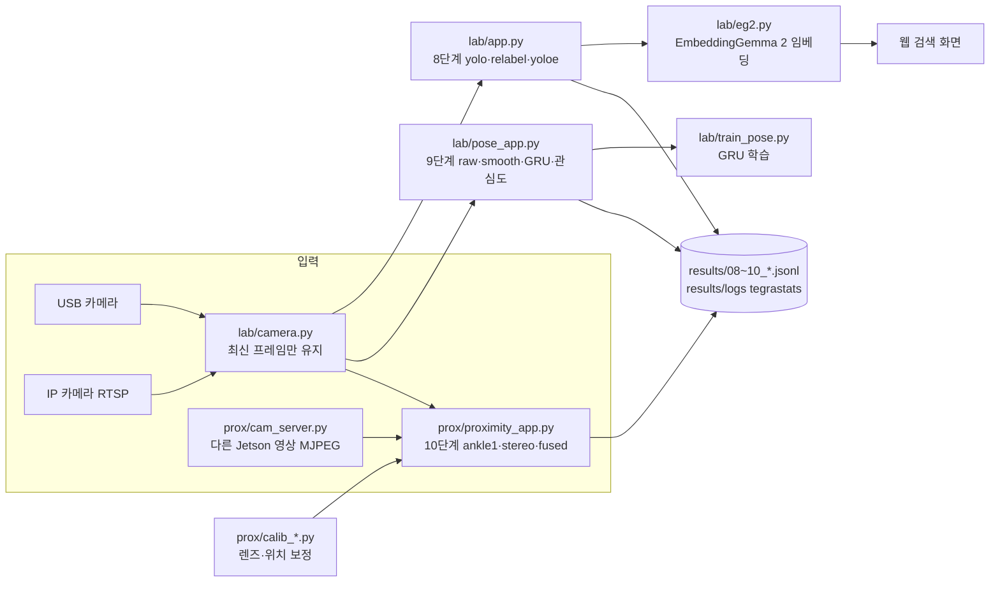

# Jetson 카메라 응용 실습 (EmbeddingGemma 2 8~10단계) — 물체 검색·동작 인식·두 카메라 접근 감지

Jetson Orin Nano Super 8GB 에 카메라를 붙여 실시간 물체 추출·검색(8단계), 사람 동작 인식(9단계), 카메라 2대 접근 감지(10단계)를 만든 과제 저장소입니다.

- **해결하는 문제**: 강의자료는 USB 웹캠 1대·JetPack 6 기준이지만 우리 2호기는 처음에 IP 카메라(RTSP)였고 1·2호기가 떨어져 있습니다. 같은 코드가 USB·RTSP·원격 MJPEG 영상을 모두 받게 하고(`lab/camera.py`, `prox/cam_server.py`), 측정은 강의자료 결과표(8-4·9-4·10-7) 형식으로 통제된 대본을 정해 쟀습니다.
- **핵심 결과** (2호기, MAXN_SUPER): 같은 물체 5종 통제 실험에서 검색 1위 정답 yolo 1 → relabel 2 → **yoloe 3개**(10.9~12.9 fps) → 강의실용으로 yoloe 선택. 같은 대본 동작 인식에서 규칙 smooth 가 만세 6/6·손흔들기 3/3, 검증 정확도 1.000 인 GRU 는 16번 더 틀려 규칙을 채택, 학습에 없는 사람도 만세 6/6(자세 인식 12.9~17.3 fps). 10단계는 렌즈 보정 RMS 0.063·1.81px, 위치 보정 재현성 0.1cm, 한 카메라 발목 방식 0.5·1.0m 에서 약 +27cm 의 일정한 오차까지 쟀고, 두 카메라 삼각측량은 카메라 구도 문제로 측정하지 못했습니다(원인과 재측정 절차 기록).
- **시연 화면** (8단계, 2호기 yoloe, 2026-10-26, 사람 얼굴·주소창 없음):
  - [세탁기 검출 화면](docs/images/08-demo-washer-yoloe.png): 화면에 띄운 세탁기 이미지를 카메라로 비추자 드럼 세탁기 두 대를 "drum washing machine 0.95·0.79" 로 잡은 실시간 영상(6.9 fps).
  - [검색창과 최근 추출 목록](docs/images/08-demo-search.png): 잘라 낸 물체 12개에 임베딩이 고른 한국어 라벨과 YOLO 라벨이 함께 보이는 화면(검출 17.1 fps, 임베딩 606 ms/개). "세탁기"·"컵"·"노트북" 검색은 상위 3개가 모두 정답.
- **범위**: 강의자료 "Jetson 실습 - EmbeddingGemma 2 멀티모달 임베딩" 의 **카메라 응용 갈래(8~10단계)**. 자료 개요가 실습을 "환경 → 임베딩 기초 → 카메라 응용" 으로 나누고 있어, 앞부분(1~7단계)은 [embedding_gemma2 과제 저장소](https://github.com/AIP-1/embedding_gemma2-AIGJ_01_002) 에 따로 제출했습니다. 8~10단계도 1~2단계 설치와 `lab/eg2.py` 임베딩 로더를 그대로 쓰므로 코드 전체가 함께 들어 있습니다.
- **문서**: [단계별 결과 (8·9·10단계 절)](docs/02-results.md#8단계-웹캠-물체-추출과-검색) · [기술적 고민과 문제 해결 과정](docs/03-engineering-notes.md) (12~32번이 8~10단계) · [강의자료 대비 점검과 셀프 채점](docs/01-self-grade.md) (1절 8·9단계 행, 6절 10단계)

## 단계별 결과 한눈에

| 단계 | 결과 | 근거 |
| --- | --- | --- |
| 8 물체 검색 | 같은 물체 5종 통제 실험(각 150초): 검색 1위 정답 yolo 1 · relabel 2 · yoloe 3개, fps 12.9 · 11.5 · 10.9 → 강의실용으로 yoloe 선택. relabel 은 tv → monitor 교정, 대신 맞는 cup 도 물병으로 바꿈 | [`results/08_objects.jsonl`](results/08_objects.jsonl), [8-4 표](docs/02-results.md#8단계-웹캠-물체-추출과-검색) |
| 9 동작 인식 | 같은 대본(만세 6·한팔들기 3·손흔들기 3)에서 smooth 만세 6·손흔들기 3 정확, raw 는 손 흔들기 판정 없음, GRU 는 검증 1.000 이지만 16번 더 셈 → 규칙 smooth 선택. 관심도 4개 상황 6/12(머무름 0/3 원인 분석). 처음 보는 사람(팀원 A): 두 방식 모두 만세 6/6, GRU 손흔들기 1/3. 악수 3회 모두 검출(카운트는 12로 부풂). 12.9~17.3 fps, RAM 3.5~4.0 GB | [`results/09_pose.jsonl`](results/09_pose.jsonl), [9단계](docs/02-results.md#9단계-사람-동작-인식) |
| 10 두 카메라 접근 감지 (일부만) | 렌즈 보정 RMS 0.063(1호기)·1.81(2호기), 바닥 보드 위치 보정 두 번 차이 0.1cm 이하. ankle1 0.5·1.0m 목표 자리 → 0.76·1.28m(오차 약 +27cm 로 일정, 25.5 fps), 좁은 공간 0.52m → 0.52m. 카메라를 숙인 탓에 2m 이상과 stereo·fused 는 측정 불가(stereo 21.7 fps·시간 차 15.5 ms). 10-6 접근 알람·10-8 이동 타겟은 하지 못함. 철거 뒤 오프라인 계산: 보정값으로 본 화면 범위가 실측 보인 비율과 일치, +27cm 중 +13~17cm 는 발목 높이 편향, 알람 로직 5개 시나리오 15/15(버그 1건 수정) | [`results/10_*.jsonl`](results/), [10단계](docs/02-results.md#10단계-두-카메라-접근-감지-2026-10-27-10-28-ankle1-만-측정), [문제 해결 24~31](docs/03-engineering-notes.md) |

8·9단계는 강의자료 요구 15개 중 14개를 실측으로 채웠습니다(남은 1칸은 선택 확장 yoloe+relabel). 10단계는 10개 중 충족 2 · 부분 3 · 미실시 5 이고, 측정하지 못한 이유를 실패 기록(문제 해결 31)으로 남겼습니다. 카메라 철거 뒤에는 보정값으로 화면 범위·오차를 계산하고 알람 로직을 합성 신호로 검증했습니다(시뮬레이션이며 실측 칸으로 세지 않음).

## 셀프 채점 (추정 루브릭 A, 8~10단계 범위)

| 항목 (배점) | 점수 | 감점 이유 / 근거 위치 |
| --- | --- | --- |
| 기술적 고민 (30) | 30 | 8단계 방식을 통제 실험 숫자로 relabel → yoloe 로 바꿈, 9단계 GRU 대신 규칙 smooth 선택(같은 사람 검증의 낙관성), 10단계 위치 보정을 바닥 체커보드 자동 계산으로 바꾼 이유. [03-engineering-notes.md](docs/03-engineering-notes.md) 판단 표 |
| 문제 해결 과정 (20) | 20 | 문제 해결 기록 12~32: 측정 실패 4건에서 "화면 확인 + 준비됐어" 절차를 만듦, 보정 구도와 측정 구도 충돌(31) 원인을 오프라인 계산으로 확인, 알람 버그(32) 수정 |
| 결과와 근거 (15) | 13 | 8·9단계는 `results/08_objects.jsonl`·`09_pose.jsonl`·tegrastats 로그로 표를 채움. **감점**: 10단계 stereo·fused 거리와 실기 접근 알람이 없고, 10-28 거리 오차는 목표 자리 기준. 올리려면 카메라를 들고 의자 위 보드(`--board-height`)로 재보정해 stereo·fused 열을 채움 |
| AI 활용과 검증 (15) | 15 | 아래 "AI 활용과 검증": AI 가 원격으로 구도를 안내한 방법, AI 실수(문제 해결 18·19·29·31)와 바로잡은 방법 |
| 구성과 가독성 (10) | 10 | 요약 → 결과 표 → 실행법, 시연 화면 설명 글 |
| 성실성·꾸준함 (10) | 10 | 10-23 → 10-26 → 10-27 → 10-28 진행 기록과 날짜별 회고 |
| **합계** | **98** | 결과와 근거 87% 로 80% 미만 항목 없음. 추정 루브릭 기준이라 강사님 채점과 같다는 보장은 없습니다 |

## 구성



| 경로 | 역할 |
| --- | --- |
| `setup/01~03_*.sh` | JetPack 판별, GPU torch·패키지 설치 (공통 기반) |
| `setup/04_install_detect.sh` | 8·9단계 검출·자세 모델(ultralytics) 설치 |
| `lab/camera.py` | USB 번호·RTSP 주소를 같은 방식으로 열고 최신 프레임만 유지, 결과 파일에는 카메라 주소를 가려서 기록 |
| `lab/app.py` | 8단계: 물체 검출 → 크롭 임베딩 → 웹 검색. `--mode yolo/relabel/yoloe`, `--probe`, `--min-score` |
| `lab/pose_app.py` `pose_model.py` `train_pose.py` | 9단계: 자세 기반 동작 판정(raw·smooth·GRU), 녹화, 관심도 |
| `prox/cam_server.py` | 1호기 카메라 영상을 MJPEG 로 내보냄 |
| `prox/calib_intrinsics.py` `calib_extrinsics_board.py` | 10-1 렌즈 보정, 10-2 바닥 체커보드 위치 보정 |
| `prox/proximity_app.py` `stereo.py` `measure_10_7.py` | 10단계 접근 감지 앱과 10-7 측정 |
| `prox/offline_10.py` `test_alarm_offline.py` | 카메라 철거 뒤 보정값 기하 계산과 알람 로직 합성 신호 검증 |
| `scripts/tegrastats_log.sh` | 측정 중 tegrastats 를 `results/logs/` 에 저장 |

## 실행 방법

아래 명령은 모두 **Jetson 에 ssh 접속한 창**에서 실행합니다. 처음 한 번만 저장소를 받습니다.

```bash
git clone https://github.com/AIP-1/practice_task_for_jetson_camera_applications-AIGJ_01_002.git ~/eg2-lab
```

```bash
cd ~/eg2-lab
```

### 1~2단계 설치

```bash
./setup/01_check_env.sh
```

출력에서 "NVMe 로 부팅 중"이면 자료의 SSD 포맷 명령을, "스왑 이미 있음"이면 스왑 추가를 건너뜁니다.

```bash
./setup/02_install_torch.sh
```

마지막에 `capability (8, 7)`, `bf16 True`, 숫자 하나가 나오면 성공입니다. `no kernel image` 가 나오면 휠이 장비와 맞지 않는 것입니다.

```bash
./setup/03_install_packages.sh
```

`torch ... cuda True` 와 sentence-transformers 6.1 이상이 출력되면 성공입니다.

### 8~9단계 카메라 응용

자료는 USB 웹캠(`cv2.VideoCapture(0)`)을 가정하지만, 2호기는 IP 카메라라서 입력을 `lab/camera.py` 의 `LatestFrame` 으로 바꿨습니다. 같은 코드가 1호기 USB 카메라(`--source 0`)에서도 돕니다. 검출이 카메라보다 느려도 최신 프레임만 처리해 지연이 쌓이지 않고, 같은 프레임을 두 번 판정하지 않습니다. `--seconds N` 을 주면 N초 뒤 끝내면서 fps·라벨·동작 횟수를 `results/08_objects.jsonl`·`results/09_pose.jsonl` 에 남깁니다.

```bash
bash setup/04_install_detect.sh
```

```bash
cd lab && python app.py --mode yolo --seconds 120
```

8-1 의 검색 확인은 `--probe` 로 남깁니다. 끝날 때 각 질의의 상위 3개(라벨, YOLO 클래스, 점수)가 결과 파일에 들어갑니다. `--min-score 0.3` 은 확장 과제의 점수 필터입니다.

```bash
python app.py --mode relabel --seconds 150 --probe 세탁기 건전지 전지 컵 휴대폰 노트북
```

```bash
cd lab && python pose_app.py --raw --seconds 120
```

9-3 녹화 → 9-6 학습 → GRU 판정, 9-5 관심도 순서입니다. 녹화는 라벨마다 하나씩(idle·만세·한팔들기·손흔들기) 30초 이상 받습니다.

```bash
python pose_app.py --record ../data/action/만세.csv
```

```bash
python train_pose.py --data ../data/action --task action --window 30 --out models/action.pt
```

```bash
python pose_app.py --model models/action.pt --seconds 120
```

```bash
python pose_app.py --behavior --seconds 360
```

브라우저에서 `http://<2호기 Tailscale 주소>:8000` 으로 실시간 영상과 검색 화면을 봅니다. 사람은 크롭·저장하지 않습니다(8단계 `SKIP_CLASSES`). 9단계는 관절 좌표만 다룹니다.

8·9단계 결과(강의자료 8-4·9-4 표 포함)는 [docs/02-results.md](docs/02-results.md#8단계-웹캠-물체-추출과-검색) 에 있습니다.

### 10단계 두 카메라 접근 감지

cam0 은 2호기 USB 카메라, cam1 은 1호기 USB 카메라입니다. 1호기에서 영상을 내보내고(포트 8140), 2호기에서 두 영상을 받아 계산합니다. 아래 명령은 2호기 `~/eg2-lab/prox` 에서 실행합니다(1호기 명령만 1호기에서). 2호기 카메라도 같은 서버로 8141 에 띄워 맥에서 화면을 확인합니다.

1호기:

```bash
python prox/cam_server.py --cam 0 --port 8140
```

2호기:

```bash
python cam_server.py --cam 0 --port 8141
```

렌즈 보정(카메라마다, 보드를 들고 여러 거리·각도로):

```bash
python calib_intrinsics.py --name cam0 --src http://127.0.0.1:8141/stream.mjpg --square 0.02
```

위치 보정(보드를 두 화면 모두에서 화면 폭 1/6 이상 보이게 바닥에 놓고):

```bash
python calib_extrinsics_board.py --cams http://127.0.0.1:8141/stream.mjpg http://<1호기 Tailscale 주소>:8140/stream.mjpg --square 0.02 --board-height 0
```

접근 감지와 10-7 측정(사람이 줄자로 잰 자리에 선 동안 10초):

```bash
python proximity_app.py --cams http://127.0.0.1:8141/stream.mjpg http://<1호기 Tailscale 주소>:8140/stream.mjpg --mode ankle1 --target-xy 0.08,-0.05
```

```bash
python measure_10_7.py --label "1.0m, 서 있음" --true-d 1.0 --seconds 10
```

카메라 없이 돌리는 오프라인 분석(보정 결과만 사용, 시뮬레이션)입니다.

```bash
python offline_10.py
```

```bash
python test_alarm_offline.py
```

카메라는 0.5~3m 에서 사람의 어깨~발목이 모두 보이게 둡니다(문제 해결 31). 보드가 화면 아래로 빠지면 의자 위에 올리고 `--board-height <의자 높이 m>` 를 줍니다. 10단계 결과와 실패 기록은 [docs/02-results.md](docs/02-results.md#10단계-두-카메라-접근-감지-2026-10-27-10-28-ankle1-만-측정) 와 문제 해결 24~31 에 있습니다.

## 진행 기록과 회고

아래 표는 [원본 개발 저장소](https://github.com/AIP-1-3/jetson_orin_LLM_agent_AIGJ_01_002)의 전체 기록입니다(1~10단계를 한 저장소에서 진행). PR 링크는 원본 저장소를 가리키고, 커밋 이력은 이 저장소에도 그대로 들어 있습니다.

| 날짜 | 한 일 | 근거 |
| --- | --- | --- |
| 2026-10-23 | 강의자료 정리, 장비 차이 분석 | [PR #1](https://github.com/AIP-1-3/jetson_orin_LLM_agent_AIGJ_01_002/pull/1) |
| 2026-10-23 | 1~6단계 설치·테스트·측정 코드 (장비 실행 전) | [PR #2](https://github.com/AIP-1-3/jetson_orin_LLM_agent_AIGJ_01_002/pull/2) |
| 2026-10-23 | 2호기 첫 실행: 환경 점검 통과, torch 설치에서 sudo 로 멈춤 → 스크립트 보강 | [PR #4](https://github.com/AIP-1-3/jetson_orin_LLM_agent_AIGJ_01_002/pull/4), 문제 해결 기록 1 |
| 2026-10-23 | 2호기 1~3단계 완료 (torch 2.14.1+cu132, 텍스트 검색 6/6 정답). 다른 프로세스 RAM 이 섞여 모델 증가분 열 추가, tegrastats 를 sudo 없이도 기록 | [PR #5](https://github.com/AIP-1-3/jetson_orin_LLM_agent_AIGJ_01_002/pull/5) |
| 2026-10-23 | 음성 샘플 생성을 파이썬으로 교체, 연속 추론 처리량 측정 추가 | [PR #6](https://github.com/AIP-1-3/jetson_orin_LLM_agent_AIGJ_01_002/pull/6), 문제 해결 기록 2·3 |
| 2026-10-23 | 2호기 3·5단계 측정 결과와 tegrastats 로그 커밋, 표에 전력·처리량 추가 | [PR #7](https://github.com/AIP-1-3/jetson_orin_LLM_agent_AIGJ_01_002/pull/7), 6단계 표, 문제 해결 기록 4 |
| 2026-10-23 | IP 카메라 녹화를 ffmpeg 에서 OpenCV 로 교체 (카메라 VIGI-C540-W 확인, 계정 입력 전) | [PR #8](https://github.com/AIP-1-3/jetson_orin_LLM_agent_AIGJ_01_002/pull/8), 문제 해결 기록 5 |
| 2026-10-23 | 카메라 연결 시험: 대역이 달라 연결 실패, 계정 가리기 버그 발견·수정 | [PR #9](https://github.com/AIP-1-3/jetson_orin_LLM_agent_AIGJ_01_002/pull/9), 문제 해결 기록 6·7 |
| 2026-10-23 | 핫스팟으로 카메라 연결, 4단계 이미지 측정 2회(28 fps 수신, 5장 2.5~2.9 초, 최대 20.2 W), 설치 스크립트에 OpenCV 추가 | [PR #10](https://github.com/AIP-1-3/jetson_orin_LLM_agent_AIGJ_01_002/pull/10), 6단계 표, 문제 해결 기록 7~9 |
| 2026-10-23 | 묶음 크기 처리량 실험·7단계 평가/학습 스크립트, 장면별 녹화 옵션, 이미지 4장씩 나눠 넣기 | [PR #11](https://github.com/AIP-1-3/jetson_orin_LLM_agent_AIGJ_01_002/pull/11) |
| 2026-10-23 | 4단계 3차 측정(10장 5.9 초, RAM 97%) 결과와 로그 커밋 | [PR #12](https://github.com/AIP-1-3/jetson_orin_LLM_agent_AIGJ_01_002/pull/12), 문제 해결 기록 10 |
| 2026-10-23 | 이미지 정답을 장면 파일 이름으로 자동 판정 | [PR #13](https://github.com/AIP-1-3/jetson_orin_LLM_agent_AIGJ_01_002/pull/13) |
| 2026-10-23 | 장면별 6장 측정(1/3 정답, 4장씩 넣어 최대 RAM 87%), 7단계 학습·평가 데이터(AI 작성) | [PR #14](https://github.com/AIP-1-3/jetson_orin_LLM_agent_AIGJ_01_002/pull/14), [data/README.md](data/README.md) |
| 2026-10-23 | 묶음 크기 실험(묶음 32 에서 처리량 22배), 8·9단계 코드를 IP 카메라용으로 작성 (장비 실행 전) | [PR #15](https://github.com/AIP-1-3/jetson_orin_LLM_agent_AIGJ_01_002/pull/15), 묶음 크기 실험 표 |
| 2026-10-23 | 7단계 기준 평가(acc@1 0.833), 학습 OOM 2회 → 임베딩 표 고정·길이 제한 추가 | [PR #16](https://github.com/AIP-1-3/jetson_orin_LLM_agent_AIGJ_01_002/pull/16), 문제 해결 기록 11 |
| 2026-10-23 | 7단계 학습 성공(acc@1 0.833 → 0.850, 일반 질의 6/6 → 3/6), 학습 tegrastats 로그, 일반 성능 확인 스크립트 | [PR #18](https://github.com/AIP-1-3/jetson_orin_LLM_agent_AIGJ_01_002/pull/18) |
| 2026-10-23 | 7단계 1 epoch 비교(acc@1 0.850 유지, 학습 74.8 초), 세 모델 일반 성능 24/24·21/24·21/24 | [PR #19](https://github.com/AIP-1-3/jetson_orin_LLM_agent_AIGJ_01_002/pull/19) |
| 2026-10-23 | 8단계 2호기 실행(yolo 11.8 fps, relabel 이 tv → monitor 교정), 종료 시 exit 134 수정 | [PR #20](https://github.com/AIP-1-3/jetson_orin_LLM_agent_AIGJ_01_002/pull/20), 문제 해결 기록 12 |
| 2026-10-23 | 8단계 yoloe(12.7 fps, 크롭 0), 9단계 자세 2회(13.6~13.8 fps, 손흔들기 23), 손 흔들기 깜빡임 수정, 대용량 모델 파일 git 제외 | [PR #21](https://github.com/AIP-1-3/jetson_orin_LLM_agent_AIGJ_01_002/pull/21), 문제 해결 기록 13 |
| 2026-10-23 | 9단계 재측정(만세 5, 깜빡임 되돌아감 5 → 1), 8단계 물건 배치 재측정(4종 11개, teddy bear → mouse) | [PR #22](https://github.com/AIP-1-3/jetson_orin_LLM_agent_AIGJ_01_002/pull/22) |
| 2026-10-23 | 10단계 1·2호기 Tailscale 연결(접근 규칙 추가), 영상 서버 포트 8091 로 변경 | [PR #23](https://github.com/AIP-1-3/jetson_orin_LLM_agent_AIGJ_01_002/pull/23), 문제 해결 기록 14 |
| 2026-10-26 | 강의자료 요구사항 37개 대비 점검(충족 19 · 부분 6 · 미실시 12)과 루브릭 A 셀프 채점(79 → 84). 8-4·9-4 를 자료 표 형식으로 정리, 동영상 프레임 대체·혼합 입력·전체 모델·검색 기록 옵션 추가, 결과 파일에서 카메라 IP 제거 | [docs/01-self-grade.md](docs/01-self-grade.md), [PR #24](https://github.com/AIP-1-3/jetson_orin_LLM_agent_AIGJ_01_002/pull/24) |
| 2026-10-26 | 마감(10/27) 맞춰 이틀 일정 수립, README 를 요약·실행법으로 줄이고 결과·문제 해결을 docs/02·03 으로 분리, 7단계 평가 데이터 사람 검수표(20쌍), 7단계 실행 명령 추가 | [docs/01-self-grade.md 5절](docs/01-self-grade.md), [docs/04-eval-review.md](docs/04-eval-review.md), [PR #25](https://github.com/AIP-1-3/jetson_orin_LLM_agent_AIGJ_01_002/pull/25) |
| 2026-10-26 | 2호기 오전 재측정: GPU 확인 로그, 3단계 프롬프트 없음 3/6, 동영상 21초 9.1 초, 혼합 입력, 전체 모델 30개 13.4 초·3/6. 2호기에 GitHub 인증이 없어 결과 커밋을 git bundle 로 옮김. 결과표가 옛 tegrastats 로그를 짝짓던 버그 수정 | [docs/02-results.md](docs/02-results.md#6단계-성능-측정), [PR #26](https://github.com/AIP-1-3/jetson_orin_LLM_agent_AIGJ_01_002/pull/26) |
| 2026-10-26 | 8-4 물체 비교 통제 실험(컵·노트북·휴대폰·건전지·세탁기 사진, 세 모드 각 150초): 검색 1위 정답 1·2·3개로 8단계 결론을 relabel → yoloe 로 변경. 웹 화면이 열려 있으면 측정 앱이 안 꺼지던 문제 수정, 셀프 채점 87 → 90 | [docs/02-results.md 8-4](docs/02-results.md#8단계-웹캠-물체-추출과-검색), 문제 해결 기록 15, [PR #27](https://github.com/AIP-1-3/jetson_orin_LLM_agent_AIGJ_01_002/pull/27) |
| 2026-10-26 | AI 가 쓴 7단계 평가 데이터 20쌍 사람 검수(민서, Y 20 / N 0), 셀프 채점 90 → 92 | [docs/04-eval-review.md](docs/04-eval-review.md), [PR #28](https://github.com/AIP-1-3/jetson_orin_LLM_agent_AIGJ_01_002/pull/28) |
| 2026-10-26 | 혼자 할 수 있는 측정을 먼저: 사람 목소리 녹음으로 음성 3/3(문제 해결 4번 원인 확인), 9-3 녹화(4라벨 2,829프레임) → 9-6 GRU 학습(검증 1.000), 9-4 같은 대본으로 raw·smooth·GRU 비교(smooth 채택), 9-5 관심도 6/12, 8단계 시연 캡처. 측정 실패 4번에서 "화면 확인 + 준비됐어" 절차를 만듦 | [02-results 9단계](docs/02-results.md#9단계-사람-동작-인식), 문제 해결 기록 16~21 |
| 2026-10-27 | 10-26 측정 결과를 문서에 반영, 시연 화면 연결, 셀프 채점 92 → 99 | [docs/01-self-grade.md](docs/01-self-grade.md), [PR #29](https://github.com/AIP-1-3/jetson_orin_LLM_agent_AIGJ_01_002/pull/29) |
| 2026-10-27 | 팀원 A 와 9단계 마지막 측정: 악수 3회(모두 검출, 카운트 12로 부풂), 처음 보는 사람 평가(smooth·GRU 모두 만세 6/6, GRU 손흔들기 1/3). 핫스팟 대역이 바뀌어 카메라 주소를 다시 찾고, 측정 중 재부팅으로 악수를 다시 잼. 셀프 채점 99 → 100 | [02-results 9단계](docs/02-results.md#9단계-사람-동작-인식), 문제 해결 기록 22·23, [PR #30](https://github.com/AIP-1-3/jetson_orin_LLM_agent_AIGJ_01_002/pull/30) |
| 2026-10-27 | 10단계 시작: 2호기 점검(VIGI·Tailscale·패키지 정상), 1호기 USB 카메라 확인(`/dev/video0`), 8091 도 사용 중이라 영상 서버 포트를 8140 으로 변경 | 문제 해결 기록 14, [PR #31](https://github.com/AIP-1-3/jetson_orin_LLM_agent_AIGJ_01_002/pull/31) |
| 2026-10-27 | 10단계 1일차: 렌즈 보정(1호기 0.063 · 2호기 1.81px), 바닥 보드 위치 보정 4번째 배치에서 성공(재현성 0.1cm). ankle1 0.52m 오차 0. 보드가 작아 위치가 2m 흔들림, 책상이 발목을 가림, 공간 0.52m 등 실패 7건 기록. 앱 메모리 기록 버그 수정 | [10단계](docs/02-results.md#10단계-두-카메라-접근-감지-2026-10-27-10-28-ankle1-만-측정), 문제 해결 24~30, [PR #32](https://github.com/AIP-1-3/jetson_orin_LLM_agent_AIGJ_01_002/pull/32)~[PR #36](https://github.com/AIP-1-3/jetson_orin_LLM_agent_AIGJ_01_002/pull/36) |
| 2026-10-28 | 10단계 2일차: 공간을 넓혀 재배치, 1호기 영상 서버 복구, 위치 보정 배치 5(재현성 0.1cm, 줄자 대조 10cm 이내). ankle1 0.5·1.0m 목표 자리에서 +0.26·+0.28m(일정한 위치 오차 분석, 자리별 줄자 값은 미기록), 2m 이상·stereo·fused 는 카메라를 숙인 구도 때문에 측정 불가로 마무리 | [10단계](docs/02-results.md#10단계-두-카메라-접근-감지-2026-10-27-10-28-ankle1-만-측정), 문제 해결 31, [PR #37](https://github.com/AIP-1-3/jetson_orin_LLM_agent_AIGJ_01_002/pull/37) |
| 2026-10-28 | 카메라 철거 뒤 10단계 오프라인 보강: 보정값으로 화면 범위·발목 편향·stereo 이론 오차 계산(실측 패턴과 일치), 10-6 알람 로직 합성 신호 검증에서 "접근 시작" 버그 발견·수정, 다음 측정 절차 정리 | [10단계 오프라인 분석](docs/02-results.md#10단계-오프라인-분석-2026-10-28-카메라-철거-뒤-새-측정-없음), 문제 해결 32, [PR #40](https://github.com/AIP-1-3/jetson_orin_LLM_agent_AIGJ_01_002/pull/40) |

### 회고 (2026-10-26)

- **잘된 점**: 모든 숫자를 `results/*.jsonl` 과 tegrastats 로그에서만 가져와 문서와 측정값이 어긋나지 않았습니다. 실패를 바로 기록해 문제 해결 과정이 14건 쌓였고, 그중 묶음 크기·1 epoch 결정은 숫자로 판단할 수 있었습니다.
- **아쉬운 점**: 8·9단계를 "일단 돌려 보기" 로 측정해서, 강의자료가 요구한 통제된 실험(같은 물체를 같은 순서로, 동작을 정해진 횟수만큼)이 빠졌습니다. 그래서 측정은 했는데 자료의 표는 채우지 못했습니다. 또 1~9단계를 하루에 몰아서 해 날짜별 기록이 하루뿐입니다.
- **다음에 바꿀 것**: 측정 전에 자료의 결과표를 먼저 열어 놓고 그 행·열에 맞게 시나리오를 정합니다. 재측정은 [점검 문서 3절](docs/01-self-grade.md#3-jetson-에서-다시-재야-하는-것) 순서대로 하고, 하는 날마다 이 표에 한 줄씩 남깁니다.

### 회고 (2026-10-27)

- **바꾼 것이 효과가 있었는지**: 10-26 에는 결과표를 먼저 열고 대본(만세 3·한팔들기 3·손흔들기 3·측면 만세 3)을 정한 뒤 쟀습니다. 덕분에 9-4 표를 숫자로 채웠고, "검증 1.000 인 GRU 가 실제로는 규칙보다 16번 더 틀린다" 는 비교가 가능했습니다.
- **새로 배운 것**: 원격 측정은 화면 밖 상황을 모르는 것이 가장 큰 위험이었습니다. 너무 가까운 구도, 뒤쪽 사람, 늦은 시작, 녹화 라벨 착각으로 측정 5번을 버렸습니다. 매번 미리보기로 사람 수·위치·머리 위 여백을 숫자로 확인하고, 본인이 "준비됐어" 라고 한 뒤에만 시작하자 그 뒤로는 다시 잰 일이 없었습니다.
- **남은 한계**: 9단계 학습 데이터가 한 사람·한 자리입니다. 10-27 팀원 A 평가에서 만세는 일반화됐지만 손 흔들기는 사람마다 속도가 달라 규칙은 부풀리고 GRU 는 놓쳤습니다. 여러 사람 녹화로 기준을 다시 정하는 것이 다음 단계입니다.
- **측정 운영에서 배운 것 (10-27)**: 네트워크(핫스팟 대역)가 바뀌거나 장비를 재부팅하면 그 회차 기록과 임시 폴더가 사라집니다. 시작 전 점검에 와이파이·카메라 주소를 넣고, 결과 묶음은 재부팅에도 남는 곳에 두도록 바꿨습니다.

### 회고 (2026-10-28, 10단계)

- **잘된 점**: 위치 보정이 실패할 때마다 jsonl 에 이유를 남기고, 판정 기준을 "재투영 오차" 에서 "두 번 잰 위치 차이 + 줄자 대조" 로 바꿔 배치 5 에서 재현성 0.1cm 를 얻었습니다.
- **아쉬운 점**: 보정용 구도와 측정용 구도를 따로 따지지 않아, 보정은 성공했는데 stereo·fused 를 한 번도 재지 못했습니다. 서는 자리의 줄자 값도 받지 않아 0.5·1.0m 오차는 목표 자리 기준입니다.
- **다음에 바꿀 것**: 보정 전에 측정 자리(0.5~3m)에 사람이 서서 두 화면에 어깨~발목이 모두 보이는지 먼저 확인하고, 그 구도에서 보드를 의자 위에 올려 `--board-height` 로 보정합니다. 서는 자리마다 줄자 값을 같은 줄에 기록합니다.

## AI 활용과 검증

- 단계: 강의자료 요약, 장비 차이 분석, 설치 스크립트와 측정 코드 작성에 Claude Code 를 썼습니다.
- 검증: 클라우드 환경에서 Python 문법 검사, 셸 문법 검사, 가짜 측정 파일로 `results_table.py` 출력 확인까지 했습니다. 2호기 실기 실행은 원격으로 진행했고, 측정값은 장비가 남긴 `results/*.jsonl` 과 tegrastats 로그를 그대로 옮겨 커밋했습니다 (로그는 필요한 항목만 뽑은 축약본).
- AI 가 놓친 점: 처음 만든 `.gitignore` 의 `.env.*` 규칙이 `.env.example` 까지 막는 것을 리뷰 중에 발견해 예외 규칙을 넣었습니다. 처음 스크립트는 sudo 비밀번호가 필요한 상황, NVIDIA 판 ffmpeg, 1초 간격 샘플의 한계를 예상하지 못했고, 모두 실기 실행에서 드러나 고쳤습니다 (문제 해결 기록 1~3). AI 가 만든 `mask()` 는 사용자 이름에 `@` 가 있는 경우를 시험하지 않아 장비 터미널에 비밀번호를 찍었습니다 (문제 해결 기록 6). 원격 연결 상태를 잘못 읽어 "재부팅으로 끊겼다"고 잘못 안내한 일도 있었는데, `uptime -s` 와 `last -x reboot` 로 재부팅이 없었음을 확인해 바로잡았습니다.
- 9단계 측정 진행 (2026-10-26): AI 가 원격으로 미리보기 화면의 관절 좌표(어깨 y, 머리 위 여백, 사람 수)를 읽어 구도를 안내하고, 측정 뒤 이벤트 시각을 대본과 맞춰 정답 여부를 셌습니다. AI 의 실수도 있었습니다. 시작 신호가 30초 늦었다고 잘못 분석했다가 로그 시각을 다시 맞춰 정정했고, 녹화 라벨을 알리지 않아 빈 만세 녹화가 생겼습니다(문제 해결 기록 18·19). 그 뒤로 본인 확인("준비됐어") 없이는 시작하지 않게 바꿨습니다.
- 10단계 측정 진행 (2026-10-27~28): AI 가 보정 결과(카메라 위치, 화면 속 보드 크기)를 읽어 배치를 다시 제안하고, 측정 줄마다 버린 이유를 `note` 에 남겼습니다. 검증은 같은 보정을 두 번 돌려 위치 차이를 보고(10cm 기준), 민서가 줄자로 렌즈 사이 거리·높이를 재서 대조하는 방식으로 했습니다. AI 의 실수도 있었습니다. 1.0m 목표 자리를 0.52m 로 잰 결과를 처음에 보정 오차로 잘못 보고(문제 해결 29), 위치 보정에 좋은 구도(카메라를 바닥 쪽으로 숙임)가 접근 감지에는 상체를 화면 밖으로 내보낸다는 점을 측정 전에 따지지 못해 stereo 를 한 번도 재지 못했습니다(문제 해결 31). 10-28 에는 서는 자리마다 줄자 값을 받기로 해 놓고 측정 때 챙기지 않아, 0.5·1.0m 오차는 목표 자리 기준입니다.
- 10단계 오프라인 보강 (2026-10-28): 카메라를 철거한 뒤 AI 가 보정 결과로 계산·시뮬레이션 스크립트를 썼습니다. 카메라 방향은 저장소에 없어 "보드 가운데를 봄" 으로 가정했고, 이 가정은 계산된 보인 범위가 10-28 실측 보인 비율(100·100·4·0%)과 같은 패턴인지로 검증했습니다. 결과는 모두 시뮬레이션으로 따로 표기했고, 실측 칸에는 넣지 않았습니다. 알람 테스트는 앱의 클래스 소스를 그대로 꺼내 실행해, 테스트용으로 다시 쓴 코드가 아닌 실제 코드를 검증했습니다.
- 평가 데이터 사람 검수 (2026-10-26): AI 가 쓴 `data/eval.jsonl` 60쌍 중 20쌍(시드 0 무작위)을 민서가 "교육생이 할 법한 질문인가, 이 문서 하나만 정답인가"로 판정해 20쌍 모두 맞다고 봤습니다. 애매했던 1건(같은 문서를 쓰는 질문)은 기준을 다시 확인해 정리했습니다([docs/04-eval-review.md](docs/04-eval-review.md)).
- 결과 점검 (2026-10-26): 강의자료 원본의 결과표·확인 포인트·확장 과제를 AI 가 저장소의 `results/*.jsonl`·README 와 대조해 빈칸을 찾았습니다([docs/01-self-grade.md](docs/01-self-grade.md)). 검증은 표의 상태 칸을 스크립트로 다시 세는 방식으로 했고, AI 가 처음 적은 집계(충족 22 · 미실시 9)가 실제 표(충족 19 · 미실시 12)와 달라 고쳤습니다. 새로 넣은 옵션(`--video-frames`, `--mixed`, `test_all.py`, `--probe`)은 10-26 2호기 측정에서 실제로 동작을 확인했습니다.

## 역할

| 누구 | 한 일 |
| --- | --- |
| 민서 | 과제 진행 전체, 2호기·카메라 연결, 측정 대상(5단계 목소리 녹음, 8단계 물건 보여 주기, 9단계 동작·관심도 연기), 7단계 평가 데이터 사람 검수, 결과 확인 |
| 팀원 A | 10-27 9단계 악수(2명)와 처음 보는 사람 평가의 측정 대상 |
| Claude Code | 측정·설치 코드와 문서 작성, 2호기 원격 실행과 구도 확인, 결과 정리(자세한 내용은 위 "AI 활용과 검증") |

## 개인정보와 안전

- 카메라 녹화·이미지(`media/`)는 사람이 찍힐 수 있어 git 에 올리지 않습니다.
- 공용 장비 규칙(재부팅, `nvpmodel`/`jetson_clocks` 변경, `apt upgrade` 금지)은 팀 저장소 `jetson_orin` 의 CLAUDE.md 를 따릅니다. 2호기는 단독 사용 장비입니다.

